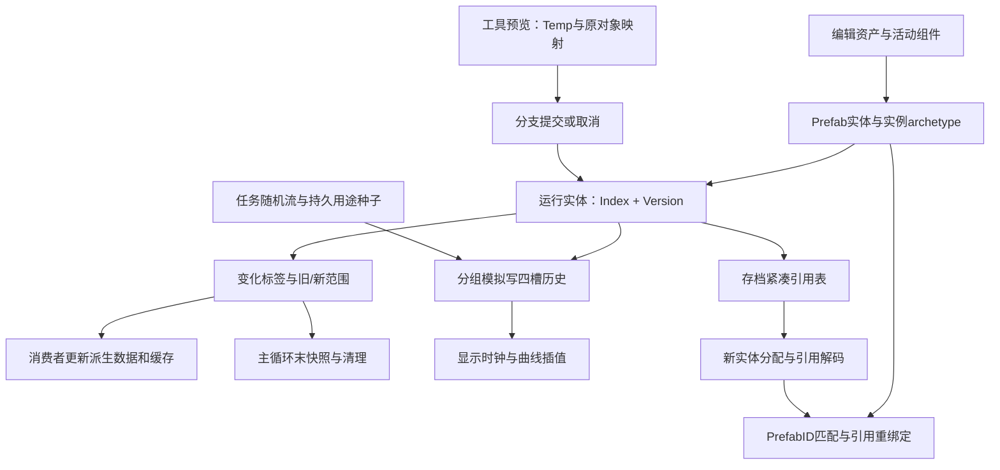

# 《城市：天际线 II》六项底层机制逐项分析

六项均已按顺序追到具体写入、依赖交接或清理落点。交付包含六篇专题、54份定向类型反编译、64个关键方法的原始CIL绑定和逐项证据台账。结论只针对这份安装版；没有启动游戏、加载用户存档或改安装目录。

| 顺序与专题 | 核心发现 | 可直接借鉴的工程思路 |
|---|---|---|
| [1. 建造预览与提交](01-建造预览与提交.md) | Temp映射旧对象；新建提升、原位更新、替换、删除分别提交 | 预览数据独立承载，身份与运行字段按操作保留 |
| [2. 增量更新与缓存失效](02-增量更新与缓存失效.md) | 变化标签→旧/新范围→邻域查询→局部去重→阶段清理 | 把失效区域和业务消费者分开，交接显式读写依赖 |
| [3. 模拟与渲染时间解耦](03-模拟与渲染时间解耦.md) | 60单位逻辑时钟、16组车辆、四槽历史、独立显示时钟 | 用时间重采样平衡规则更新成本与画面连续性 |
| [4. 实体身份与引用修复](04-实体身份与引用修复.md) | 代际Entity、文件紧凑编号、PrefabID三层身份 | 加载先建身份再解引用，资产再做语义重绑定 |
| [5. 并行随机与可重复性](05-并行随机与可重复性.md) | 时间起种与Chunk流并存，实体用途种子持久化 | 并行局部随机与稳定特征分工，明确复现范围 |
| [6. 资产到运行数据编译链](06-资产到运行数据编译链.md) | 组件声明、依赖闭包、LateInitialize、专用数值转换及替换收尾 | 编辑数据面向生产效率，运行数据面向密集访问 |

六条链可以连成下面的生命周期。图表达本轮已观察到的接口关系，不是单线程全局串行调度图：

最值得迁移到自己项目的是边界设计：配置与运行状态分离、预览与提交分离、生产者标记与消费者重算分离、权威时间与显示时间分离、运行身份与持久身份分离。这些边界靠组件、表和阶段协议落实。ECS和多核Job提供执行手段，不会自动完成缓存一致性、引用迁移或随机复现。

对应代价也已明确：旧对象映射和fence使生命周期变复杂；宽泛标签及重复范围放大工作；历史环带来显示延迟；Prefab替换要求遍历并修补多类引用；Chunk随机流受实体布局与抽样次数影响。专题中把已观察实现、工程推导和未确认范围分别注明。

64个方法覆盖Game.dll、Colossal.Core.dll、Unity.Entities.dll、Unity.Mathematics.dll；50个Game方法另从保留IL清单按RVA和结束方法名核对体积。方法体哈希验证用于绑定构建与证据，不等于独立证明反编译语义，也不证明运行性能。详见[核验说明](verification.md)、[方法清单](selected-methods.json)、[逐项台账](analysis-status.json)。

仍需运行证据的内容是实际耗时、峰值内存、失效命中率、显示延迟、缺失Mod读档效果和跨机器复现。这些没有用静态参数代替测量；遵守“先不开游戏”，本轮不采集运行数据。此前九轮证据继续保留，前一轮管线材料不在本资料包内可对照渲染上传、GPU水面和寻路工作图部分。
