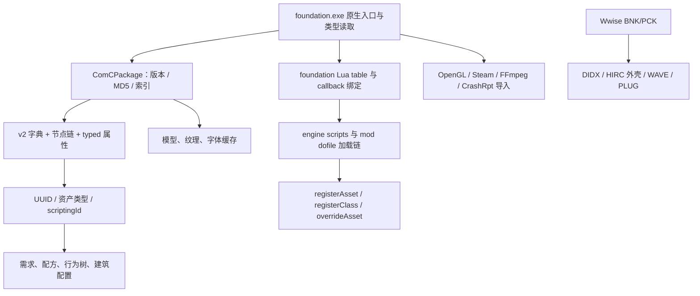

# Foundation 静态逆向调查交付报告

日期：2026-10-13。目标：`D:\steamtest\steamapps\common\Foundation`，版本 **1.12.0.14 - steam**。

本次已完成安装产物、资源包、对象序列化、全量原生覆盖、玩法语义、模型/纹理/着色器、音频媒体、Mod 接口和容器的静态调查及可复查交付。交付的是完整逆向资料与全部资源导出；它不是可编译游戏源码重建。运行时界面观察因用户按 Escape 取消，没有取得运行时结果。

## 完成范围与证据

| 调查问题 | 完成结果 | 验证与边界 |
|---|---|---|
| 安装身份 | 731 文件，4,851,283,262 字节；全部 SHA-256 清单 | 16 个根目录文件与首轮 baseline 一致 |
| 主程序 | x64 PE32+，版本 1.12.0.14；全量 `.text` 指令、调用引用、RTTI/COL 与 194,922 个函数记录 | 194,904 份 Ghidra C 反编译成功、18 份失败保留原始汇编/函数体；没有执行身份推断 |
| 资源包 | 7 包，34,884 文件、1,929 目录 | 全部 MD5、计数、索引、目录跳过地址与连续数据覆盖通过 |
| 原生代码 | 194,922 个函数记录，194,904 份完整 C 输出、10,557,895 条指令及全量调用引用 | 18 个失败地址列在失败清单；31,060 个 chained-unwind 片段仍按片段保留 |
| 标准对象 | 26,290 项 v2 对象完整解码 | 独立重编码与原始文件逐字节一致，零错误 |
| 其它 `.meta` 缓存 | 2,418 项格式归属与结构验证；全部 34,884 包资源和 724 loose 文件已导出 | 904 模型 metadata、904 geometry cache、1,172 DXT、2,817 PNG、39 TIFF、6 Radiance HDR、字体与 WebM 均保留原字节 |
| 资源声明与 schema | 15,589 个唯一 UUID、391 种资产类型 | 无重复声明；未匹配 UUID 不能判定为坏引用 |
| Mod 示例 | 3 ZIP、75 成员、34 份脚本/配置原样保存 | 904 JSONC snippet、本体 17 语言/578 JSON 解析成功 |
| 音频目录 | 3 BNK、2 PCK，2,041 媒体或数据项；1,939 项解码为 PCM16 WAV | 全部目录、子块范围、WAV 长度与 SHA-256 通过；未播放声音 |
| 运行时 | 用户取消界面启动观察 | 未取得主菜单、Steam/DLC 状态或实际执行证据 |

## 全量恢复阶段交付

### 原始资源与格式

`outputs/foundation-resources/export-summary.json` 记录 7 个 package 的 34,884 个 payload 和 724 个 loose 文件。所有导出文件都重新读取并以 SHA-256 绑定到原包偏移或安装清单；`packages/` 与 `loose/` 目录保留原始相对路径、文件名和字节。格式目录将 26,290 个对象、904 个模型 metadata、904 个模型 buffer cache、2,670 个 shader source、1,172 个 DXT cache、2,817 个 PNG、39 个 TIFF、6 个 Radiance HDR、22 个 WebM、字体和 Houdini 几何逐项列出。DXT 已转换为无损压缩块 DDS 与 top-mip PNG；438 个带扩展名错位的标准图像/HDR 已生成 byte-exact 副本和预览，原始压缩块与浮点样本仍保留。shader 交付是源文本/宏与 uniform 索引，没有宣称已编译 GPU 程序。

### 原生函数与类型

`outputs/foundation-full-native/FULL_NATIVE_README.md` 是全量覆盖入口。Ghidra 12.1.4/JDK 21 在固定 PE `.text` 上生成 194,922 条函数记录、10,557,895 条指令和完整的原始汇编/调用索引；194,904 条取得完整 C 反编译，18 条在失败清单中保留超时、进程退出或 varnode 错误及原始函数体。指令分区闭合，未分配字节、31,060 个 unwind fragment、33,202 个 RTTI 类型描述符和 25,415 个严格匹配的 COL/vtable 候选均单独保存。12 个已安装 PE 组件（主程序、引擎 DLL、Steam 与 LuaSocket 等）有独立导入/导出/段/调试/签名字段清单；这些字段不等于运行时加载证明。

### 玩法语义与关系图

`outputs/foundation-game-systems/SEMANTIC_GUIDE.md` 将 34,884 个物理资源映射到 26,290 个解码对象：生产、工作、需求、村民状态、建筑、贸易、幸福度、任务、军事、地图和行为树均有 JSONL/CSV/图文件。语义索引包含 70 个行为图、817 个节点、735 条边（19 个不可达节点仍保留）、106 个配方和 3,281 个具体条件节点；声明/引用表记录 312,393 个声明、78,265 个解析资产引用与 1,466 个未解析出现。验证文件失败数为 0。

### 模型、骨骼、动画与纹理

`outputs/foundation-models/README_MODEL_RECOVERY.md` 记录 904/904 个 metadata 到 EOF 的解析和 904/904 个 GLB 的结构校验。GLB 合计 81,576 个 mesh、24,103,457 个顶点、55,061,373 个索引、3,010 个 morph target、588 个动画缓存和 93,103 个源树节点；73 个 glTF skin 实例通过矩阵残差验证，510 个无法严格证明的骨骼绑定和 508 个没有 source hierarchy 的候选保留 raw 数据及 sidecar 问题记录。按全部材质引用统计，2,510 条同包 basename 唯一匹配、24 条歧义、1,011 条未找到；纹理状态逐模型保留。GLB 是互操作静态恢复，不是厂商原始 FBX 或运行时最终画面。

### 音频与媒体

`outputs/foundation-audio-recovered/README_AUDIO_RECOVERY.md` 包含 2,041 个原始 WAVE/PLUG carrier（631,973,428 字节）和 1,939/1,939 个 PCM16 WAV（48 kHz，合计 13,969.164 秒）。3 个 bank 的 5,011 个 HIRC 对象、242,663 个字段、24,614 条引用和 432 个 Event 的静态路径均保留；2,806 条 Event→Action→Sound→media 路径、365 个连到媒体的 Event、102 个 PLUG 到卷积混响的映射和 9 个 opaque 参数块有单独证据。两个缺失 Play target、72 个未解析 tid 以及 opaque 参数均明确列出，未伪造运行时行为。

## 已还原的关键数据流

图中的包、对象与 Lua 关系有原生函数或结构字节证据。渲染、平台、音频的运行时触发没有被观察；HIRC 外壳的对象标签不等于事件逻辑已经还原。

### 包格式已经得到代码核证

版本 2 的头部是 u32 version、32 字节 ASCII MD5、u32 dataOffset、u32 totalFiles、u32 rootEntries。MD5 覆盖文件偏移 36 至 EOF；构造函数是否校验由传入参数控制。

文件条目是 u32 名称长度、名称、u8 目录标志，随后两个 u64：数据区相对偏移和长度。原生函数 **`0x1401507e0`** 连续执行两次 8 字节读取，完整组合高低 32 位，消除了首轮宽度推断。目录项的 childCount/skipOffset 是 u32，skipOffset 为子树结束后的绝对索引地址，1,929 个目录均验证通过。

### 对象与实际配置已可阅读

v2 对象使用 UTF-8 名称字典，以及 16 字节节点（名称、同级、首子节点、首属性）和 12 字节属性头（名称、下一个属性、类型）。整数、浮点、bool、字符串和 GUID 的类型编号由原生 reader 明确实参核证。

以下是本版本包中的配置值，并由 UUID 匹配具体资源：

- 风车：**4 WHEAT → 1 FLOUR**。
- 面包房：**3 FLOUR + 1 WATER → 5 BREAD**。
- 鸡舍：最多 5 个动物；配置的产出循环分别为 1 EGGS / 90 秒、1 CHICKEN / 160 秒，喂食 cooldown 180 秒。
- 基础食物需求：FillDurationInSeconds=630、GracePeriod=180、DelayAfterUnsuccessfulFill=60，幸福度引用到 HAPPINESS_FACTOR_LACK_FOOD。
- 农业行为树：13 节点、12 连接，已解析资源补给和交互工作分支、变量与资源引用。

这些是发布配置，不是测得的单位实际吞吐量；加成、AI 节点执行和循环调度仍由代码决定。展开对象、字段、引用目标和字节位置均已保存。

### 缓存与音频结构已闭合

额外 2,418 个 `.meta` 为 904 FBX xbin、1,172 S3TCDXT、297 PNG、36 TIFF、9 字体缓存。模型目录包含 588 动画、81,576 网格记录，24,103,457 顶点和 55,061,373 索引；索引范围、顶点步长和形态目标数量均通过结构检查。PNG 验证 CRC/zlib/扫描线，TIFF 验证 IFD/strip/解压长度。

音频项为 1,939 个 48 kHz、Wwise Vorbis 标签的 WAVE，以及 102 个完整 PLUG 容器；另枚举 5,011 个 HIRC 对象外壳。PCK 内嵌的三个 bank 与独立文件 SHA-256 完全一致。计数排除内嵌 bank 重复载体，不能理解为不同音效数。

## 交付入口

- [原生函数报告](foundation-native-analysis/NATIVE_ANALYSIS.md)：函数地址、伪代码、汇编、调用引用、分析配置与复建脚本。
- [对象与缓存报告](foundation-serialization/SERIALIZATION_REPORT.md)：完整格式、数据类型、UUID/schema、玩法对象与缓存验证。
- [音频报告](foundation-audio/FOUNDATION_AUDIO_ANALYSIS.md)：媒体 CSV、HIRC 目录、容器结构与原作者源码出处。
- [Mod 与交付系统](foundation-systems/SHIPPED_SYSTEMS.md)：示例注册链、事件、职业、配方及本地化。
- [全部资源文件 CSV](foundation-package-evidence/package-files.csv) 与 [完整包索引](foundation-package-evidence/package-inventory.json)。
- [全部对象 JSONL](foundation-serialization/decoded-resources.jsonl.gz)、[缓存 JSONL](foundation-serialization/decoded-caches.jsonl.gz)、[UUID 定义](foundation-serialization/uuid-definitions.json)。
- [Ghidra 数据库备份](foundation-native-analysis/focused-ghidra-project.zip) 与 [逐文件备份校验](foundation-native-analysis/database-backup-manifest.json)：原始数据库保留在 work，备份 ZIP 的 CRC/成员 SHA-256 已验证。
- [完整安装哈希清单](foundation-systems/installation-manifest.json)、[原文件完整性检查](foundation-systems/source-integrity-check.json)、[综合验证](INTEGRATION_VERIFICATION.json)。

## 方法、证据来源与验证

REA 的完整 PE 资源 Evidence 是 `ev_52f0c67a21803d02f80b2874f77ba358931ca943845d562e48a7ab9f6f56abe2`，保存在 [REA bundle](foundation-package-evidence/rea-evidence-bundle.json)。其它新增结论来自明确标识的本地包解析或定向 Ghidra 证据，没有编造 REA Evidence ID。

全量原生阶段采用已安装的 Ghidra 12.1.4/JDK 21、8 GiB 堆、固定 worker 数和可复查脚本，按 `.pdata`/leaf 边界生成函数并保存每条指令、汇编、C 输出、调用引用和失败记录。18 条失败不被填充为猜测源码；诊断字符串只用于辅助归属，函数名仍为 `FUN_...`。

验证采用最小充分检查：7 包全量结构/MD5；26,274 对象独立重编码；2,418 缓存格式检查；5 音频容器结构与 bank 哈希比对。交付时另复核原生 237 个文件与序列化 97 个文件的 manifest 哈希，并用保存脚本再验证一份 NeedFoodBasic 对象的 typed 值及逐字节重编码，没有重复运行全部分析。

所有原始安装文件只读。替代样本保存在 work/abandoned；分析脚本、报告、证据、解码结果及数据库 ZIP 纳入 Git，数据库原目录保留。PROJECT.md 保存最终项目状态。

## 剩余边界

未取得运行时证据：用户按物理 Escape 停止 Computer Use 后，没有继续任何界面操作。该取消记录在 [runtime-status.json](foundation-runtime/runtime-status.json)。

未覆盖整个游戏的所有函数与虚表；Ghidra 伪代码不是原始可编译源码。压缩对象/v3 header 分支有原生代码证据，但解码器目前验证的是本次实际遇到的未压缩 v2。模型辅助字段、动画后置 13 字节、字体 metric 分量、HIRC 负载和 PLUG 语义仍保留未知。这些限制不会阻止本次已列的安装结构、格式与重点代码调查交付。
