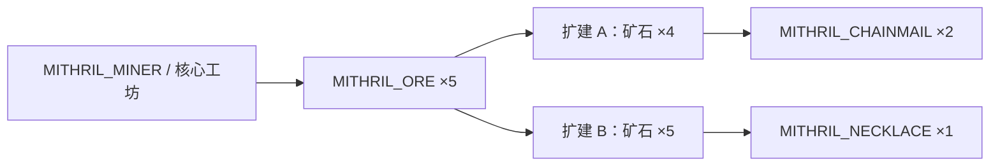

# 随游戏交付的系统与 Mod 接口证据

这些文件来自安装目录和随游戏交付的 ZIP。本次只做静态读取，没有执行 Lua；下文的示例数值不代表原版游戏经济数值。

## Mod 接口

三份 ZIP 共 75 个成员，其中 34 个 Lua/JSON/文本文件按原路径保存并记录 SHA-256。`mods/vs-code-snippets.json` 是带尾逗号的 JSONC，解析后包含 904 个 snippet 条目。

| 交付示例 | 可观察的接口 |
|---|---|
| Example Simple | createMod、registerAssetId、dofile、registerEnumValue、registerAsset、overrideAsset、行为树节点注册 |
| Example Mithril Factory | BUILDING_FUNCTION_WORKPLACE、RESOURCE、JOB、生产输入/输出、零件与自定义组件 |
| Example Taxation | registerClass、TAXATION_FUNCTION_BRACKET 继承、事件注册/清理、税务设置追加 |

## 一条完整的生产声明链

Mithril 示例定义：核心工作场所容量 4，职业 MITHRIL_MINER，每次 ResourceProduced 声明 MITHRIL_ORE ×5；扩建 A 容量 1，职业 MITHRIL_ARTISAN、MY_CUSTOM_BEHAVIOR_TREE，输入矿石 ×4、输出链甲 ×2；扩建 B 容量 1，输入矿石 ×5、输出项链 ×1。这些值来自 [building_functions.lua](mod-examples/Example%20Mithril%20Factory/scripts/mithril_factory/building_functions.lua)。

职业声明将 MITHRIL_MINER / MITHRIL_ARTISAN 追加到 STATUS_VILLAGER_SERF 的 CompatibleJobList。资源声明将链甲分类为 GOODS、项链分类为 LUXURY。扩建 A 的行为树 ID、职业 ID、资源 ID 因而具备可追踪的脚本联系。

## 事件与行为树

税务脚本监听 ON_COMPONENT_INITIALIZED / ON_COMPONENT_DESTROYED 和每个税务办公室的 ON_TAX_DEPOSIT；计算 `_goldAmount * taxPercentage`，用 INST_TAXATION_COLLECT_INFO_BUILDING 与 GOLD_COINS 记录累积税务信息。MaximumAmount 默认 50，TaxPercentage 为 0.1；finalize 用 event.clear(self) 清理注册。证据：[TaxationFunction.lua](mod-examples/Example%20Taxation/scripts/TaxationFunction.lua)。

守卫示例检查工作场所存在且启用；从建筑零件中收集未分配士兵的 COMP_GUARD_LOCATOR，随机选择后 assignSoldier，并设置两个左右巡逻位置。缺少工作场所或守卫点时返回 FALSE，完成设置时返回 TRUE。证据：[node_setup_guard_locator_post.lua](mod-examples/Example%20Simple/guard_behavior_tree/node_setup_guard_locator_post.lua)。

## 本地化与组件声明

本体 localization 下 17 个语言目录，共 578 个 JSON 文件；所有文件均解析成功，根键和 SHA-256 已记录。该本体计数不包含 DLC 本地化。成就 VDF 提供 token 显示文本，不是条件执行代码。

third-party-legal-notices.txt 分隔的 31 段组件声明已保存在清单中，其中包括 Lua/LuaJIT、Dear ImGui、RapidJSON、Bullet、GLEW、libcurl、FFmpeg 等；文件声明存在不等于所有功能都被执行。

## 交付与验证

- [系统清单](shipped-systems-inventory.json)：ZIP 成员、哈希、JSON 根键、snippet 前缀与音频区块。
- [原样保存的 Mod 脚本](mod-examples/)：按 ZIP 名分别保存。
- [分析脚本](inspect_shipped_systems.py)：只读安装文件，写入本项目输出目录。

本次未将示例安装为新 Mod。ZIP 脚本提取成功、本体 578 个 JSON 均可解析、904 个 JSONC snippet 已解析。完整音频目录由 ../foundation-audio/ 独立交付。
