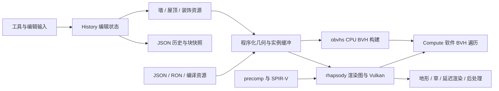

# Tiny Glade 逆向分析与工具包

目标：`C:/Steam/steamapps/common/Tiny Glade`。分析日期：2026-10-13。交付的是本地安装制品的系统性逆向报告、可复用解析/提取工具、原始证据及验证结果。游戏安装和存档均未修改；没有启动游戏。工程与调查结果由工作区本地 Git 备份。

当前还原已包含独立屋顶、墙板规划、楼梯地形/碰撞查询代码，全部670模块的可编译GLSL及已验证派生SPIR-V，完整纹理/植被/prefab结构、纹理recipe哈希，以及全量FMOD PCM和Studio元数据。正在继续完整墙板实例装配、原生项目函数导出及剩余运行链。原始Rust/Slang文本不在制品中；伪代码、翻译源码、独立实现和原程序执行证据分别保留。数字限定其样本集合，不作为整个游戏完成百分比。

## 当前恢复与验证

| 范围 | 已恢复结果 | 验证边界 |
|---|---|---|
| 安装/EXE/PDB | 2078文件；匹配PDB；94072过程记录 | 原安装只读；清单BLAKE3/RSDS配对 |
| CPU索引 | 70804函数、509806直接调用 | .text98.614%静态解码不等于行为覆盖 |
| 原生项目源码归属 | 7559函数/10162896B，对应全部保留私有源码行 | 伪代码批量导出进行中；质量逐项保留 |
| 屋顶瓦片 | 圆形高层＋矩形低层独立Python源码 | 3722旧records、额外真实快照912 records全bit exact |
| 屋顶运行 | 动画、SparseWriter push/page增长、GPU gravity | GPU1542更新；height误差≤9.54e-7，rotation≤2half最小ULP |
| 墙/楼梯 | 完整横竖planner、world门窗/拱洞、地形、实景raycaster | 84+175+116+90组第二阶段原程序比对；完整实例装配进行中 |
| 资源 | 621完整DDS、504descriptor、完整植被结构与packed字段 | 6146层/mip原指令验证；24prefab目录继承 |
| 资源ID | AssetRecipeId/Hash128/TextureOpts、Ready/无prefix文件源 | 19完整纹理recipe原代码验证；Windows prefix进一步还原中 |
| Shader | 670完整GLSL，555distinct全部compile | host接口670/670一致；最终SPIR-V scalar-layout profile验证全通过 |
| 存档 | 68快照/44history及精确原块重组 | 旧版本迁移/完整history重放未全部实现 |
| 音频样本 | 18FSB/4807全量PCM decode，累计93.38GB | header帧数/声道/rate/name全匹配，保留全部PCM哈希 |
| 音频事件 | 604event/snapshot描述、1591参数出现、61global | Studio零instance/样本未加载；GUID图不当作精确播放时序 |

专项报告：

- [屋顶独立源码](reports/reconstruction_roof.md)、[动画/缓冲与GPU](reports/reconstruction_roof_runtime.md)。
- [墙/楼梯初步内核](reports/reconstruction_wall_stairs.md)、[完整planner/真实碰撞链](reports/reconstruction_wall_pipeline.md)。
- [完整资源语义与recipe](reports/reconstruction_resources.md)。
- [全部着色器源码与验证](reports/reconstruction_shaders.md)，最终模块索引在 reconstruction/shader_source_index.json。
- [全量音频PCM](reports/reconstruction_audio_pcm.md)、[Studio事件及bank关联](reports/reconstruction_audio_studio.md)。
- [存档](reports/saves.md)、[save/load 输入阶段重建](reports/reconstruction_save_load.md)、[PDB与源码行](reports/pdb.md)、[初轮CPU/BVH](reports/native.md)、[初轮资源](reports/assets.md)。初轮报告记录当时边界，新增恢复结论以上述reconstruction专项报告为准。

## 已恢复的关键机制

CPU 屋顶创建读取墙状态并构造 ECS 组件，瓦片汇编路径区分圆形与矩形。完整圆形/矩形瓦片生成已移植为独立Python并与原指令生成记录比对。历史保存的是墙、屋顶、装饰、树、地形等参数状态和编辑序列；快照采用 JSON 场景块加独立 DEFLATE 栅格块。

地形拾取 shader 从上界到下界做最多 1,000 次固定步进，采样高度并保留穿面前一点。草路径读取烘焙叶片属性，执行实例变形、地形贴合及 GPU 筛选，生成间接绘制命令。GI/水反射 shader 使用 80 字节压缩宽 BVH 节点和 24 字节压缩三角形的软件遍历；CPU 构建路径直接调用 obvhs 的 splitting、PLOC、reinsertion 和 CWBVH 转换。

以下图为静态证据支持的架构解释；实际帧调度没有运行采集：



## 使用工具

在此目录运行。Python 3.11+。PDB、save 和 shader 工具使用标准库；BLAKE3 检查、PNG、Capstone 指令和 Unicorn 模拟需要 requirements.txt 中的依赖。可在独立环境安装，工具不依赖本次 work 临时目录。

```powershell
python -m venv .venv
.\.venv\Scripts\python.exe -m pip install -r tools/requirements.txt
```

用新输出路径保留既有证据。常用操作：

```powershell
# 查函数与原始源码位置
python tools/pdb_query.py evidence --address 0x140b770a0
python tools/native_graph_query.py evidence/native_callgraph.sqlite --name build_gpu_bvh --direction callees --limit 30

# 导出资源
python tools/assets_tool.py textures --root 'C:/Steam/steamapps/common/Tiny Glade' --out new-textures --all --png
python tools/assets_tool.py meshes --root 'C:/Steam/steamapps/common/Tiny Glade' --out new-meshes
python tools/assets_tool.py compiled-meshes --root 'C:/Steam/steamapps/common/Tiny Glade' --out new-foliage

# 解析并提取全部 shader
python tools/shader_precomp.py 'C:/Steam/steamapps/common/Tiny Glade/compiled-shaders' --output new-shaders --extract
python tools/shader_spirv.py new-shaders/spirv --output new-reflection --instructions --assembly
python tools/shader_verify.py new-shaders/shader_containers.json new-reflection/shader_reflection.json --output new-shader-validation.json

# 快照无损归档与还原
python tools/save_inspector.py extract 'path/to/file.snapshot' --out new-snapshot
python tools/save_inspector.py repack new-snapshot --out new-restored.snapshot
python tools/recovered_save_load.py load 'path/to/history.json'
python tools/recovered_save_load.py audit --root 'C:/Steam/steamapps/common/Tiny Glade/assets' --out save-load.json
python tools/verify_recovered_save_load.py

# 对当前 EXE 重验恢复公式
python tools/roof_math.py --verify 'C:/Steam/steamapps/common/Tiny Glade/tiny-glade.exe' --out new-roof-verification.json
```

依赖环境中使用 `.venv/Scripts/python.exe` 代替示例的 python。完整索引生成和 Ghidra 的复现见专项报告与 Java 文件头。Ghidra 脚本只处理私人分析 project，先验证 EXE/PDB 匹配后才使用地址 TSV。

`evidence` 保留完整符号 JSONL、源码行 CSV、只读 SQLite、SPIR-V、反射、指令和核心汇编。`extracted` 是本次导出的网格与少量纹理/声音实例，可从原安装重复生成；工具包归档不包含这批大型重复产物。`deprecated` 保存已替代的分析及质量不合格的伪代码，不作为当前结论的依据。

v2交付文件摘要在 `SHA256SUMS.json`，当前便携包为 `../Tiny-Glade-reverse-analysis-v2.zip`（SHA-256 请用 Get-FileHash 或 Python 计算，避免摘要自引用）。使用 `python tools/verify_bundle.py .` 可只读检查13848个工具、报告、源码、证据文件；v1摘要/ZIP已移动到 `deprecated/first-delivery`。

## Grass2 packed record decoder

`tools/grass2_reference.py` decodes the exact 16-byte clump, packed card-position, plant-offset and visible-instance fields used by the shipped `grass2/card_splats` shader. It is a byte/layout decoder; the GPU cull/scan/wind/indirect-draw pipeline remains a separate unresolved runtime subsystem.

## 未解决范围

完整原生函数的可维护高层源码、墙体全部实例装配/region/gable/merlon特例、全部装饰生成、history版本迁移与重放、完整场景更新生命周期、实际渲染图调度/材质和游戏交互仍未全闭合。已有实景raycaster采用独立median BVH，并未冒称原Rapier QBVH构建算法。shader通过编译/host接口验证不证明所有画面等价。

具体进度以根PROJECT.md与专项证据为准。当前v2摘要/便携ZIP已通过只读验证；可再生extracted输出仍不纳入包。首轮版本已在Git标签tiny-glade-analysis-v1和deprecated/first-delivery保留。
