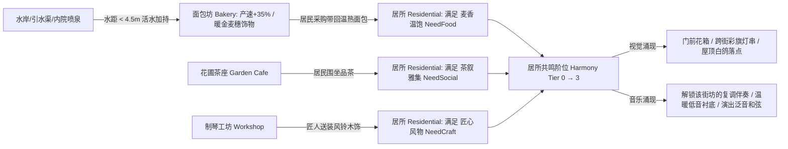

# 《共鸣之城》v3.0 游戏策划与三库玩法深化指南

> **2026-10-16 工程校准（施工以本段为准）**
>
> 本文以 `f0a916e6b` 为历史快照；当前状态读根 `PROJECT.md`，不要把路线或示例写成已完成功能。
> - 当前作品兼容Schema 1～11；11保存可选自然轮廓，10保存柔化笔刷，9保存手动连线。旧版代码行数、135脚本/378测试及导出配额是历史数据，归档数量以实际依赖计划为准。
> - 清理只使用实际 `tools/cleanup_v3_workspace.py`：默认dry-run，复核JSON后 `--apply`；解析res路径、UID和全局类闭包，唯一归档、不删除、不覆盖。保留三套原件、三库、个人数据与现有验证记录。不能按前缀硬移共享依赖。
> - <35ms准备、<12ms最大帧和15MB减负是目标，不是当前实测保证；基于同机同样例重新测量。2个MultiMesh节点也不等于各视角恰好2个Draw Call。
> - 现有采购、茶叙、工坊送装、演出与余韵已经连通。幸福度必须读取每户真实采购/茶叙凭据，禁止把全城 `served` 或 `tea_parties` 当成每户完成。
> - “产速提高35%”统一用速率×1.35：6秒约4.44秒、8秒约5.93秒；不能同时声称耗时减少30%。林木半径统一8米；跨街彩旗须检查邻屋/悬索障碍并随实际编辑发布更新。
> - `P`保留点房试听，明信片用 `F12`；街头漫步、第四章、墙体/水面示例等以集成和验证记录登记进度。
> - Shader与GDScript块是适配起点。墙体AO须匹配合批后的坐标/顶点色；水沫倒置smoothstep改为 `1.0-smoothstep(0.06,0.28,depth)`；草色用同镜头昼夕夜实图判断。
> - 三套用户提供目录保留原文；本目录为当前修订施工版。原示例源码留在用户目录，实际实现以 `scripts/` 与根工具为准。

*(配套总蓝图：`文档/code_artifact.md` · 深度融合 Tiny Glade、Townscaper 与 Foundation 核心机制)*

## 1. 核心玩法循环诊断与进化方向

《共鸣之城》的核心魅力在于**“建筑即乐器、街坊即乐章、居民生活即节拍器”**。在 v2.0 完成了 9 大工具、高地石阶、石板灯街、圆塔/花房/柱廊、汀步睡莲与手动共鸣连线后，当前策划层面的提升空间在于**将孤立的功能点编织成有机的生态闭环**：

| 策划维度 | 当前 v2.0 状态 | v3.0 进化目标（三库机制赋能） |
| :--- | :--- | :--- |
| **指尖建造触感** | 点击建房/加层时仅有静态网格出现与单音拨弦 | 引入 **Townscaper `VoxelBobEffect` (`3d5000.c`)** 弹性按压回弹动画 + **按住滑动“街巷八音盒连续刮奏 (Street Harp Glissando)”** |
| **箱庭生命气息** | 场景中仅有沿路行走的居民圆偶，屋顶与水面缺乏生灵互动 | 引入 **Townscaper `BirdFlock` (`879180.c`) 屋顶白鸽群（建房/拨弦时振翅惊飞）** + **`ButterflyFlock` (`8811c0.c`) 日间花间彩蝶 / 星夜池畔流萤** + **`PropWire` (`758e50.c`) 跨街彩旗与暖灯串** |
| **生产与选址策略** | 面包坊、制琴坊、茶座无论建在哪里效率完全相同 | 引入 **Foundation 环境选址加持 (`Site Blessing`)**：临水/喷泉面包坊获「活水磨坊加持」（提速35%+每炉+1）、临林工坊获「良木林间加持」、临宽街/池塘茶座延展余韵 |
| **居民幸福与音乐反馈** | 居民买面包、喝茶、装木饰只增加账本数字，不反哺世界 | 引入 **Foundation 居民需求与幸福度 (`SEMANTIC_GUIDE.md`)**：居所满足「麦香温饱 + 茶叙雅集 + 匠心风物」升至 **0~3 阶共鸣度 (`Harmony Tier`)**，自动解锁门前花丛、跨街彩旗，并直接提升街坊复调伴奏音轨 (`terrace` / `foundation`) 的丰满度 |
| **终局目标与观赏体验** | 手记仅有三章，视角锁定正交俯视 | 扩充**第四章手记「星夜百鸟与立体交响」**（奖励第8套配色「星夜鎏金与月白」），新增 **`V` 键街头第一视角透视漫步与移轴明信片拍照模式** |

## 第五部分：游戏策划、箱庭生命生态与音乐交互大进化（三库精髓深度融合）

### 5.1 Townscaper 启发式“指尖触感反馈 (`VoxelBob`)”与“街巷八音盒刮奏 (`Street Harp Glissando`)”

#### 5.1.1 建筑建造与点按的弹簧形变反馈 (`VoxelBobEffect` — 源自 `Townscaper 3d5000.c`)
- **三库依据**：在 `参考资料/Townscaper逆向成品/outputs/townscaper_interaction_presentation.md`（`3d4dc0.c` / `3d5000.c`）与 `townscaper_shader_algorithms.md`（`_PressPosAmount`）中，玩家每次点击新增、拔高、染色或触碰建筑时，建筑都会产生一次极具触感的**下压与弹性回弹（Squish & Spring Bounce）**。
- **直接可落地实现（在 `scripts/visual/city_creation_renderer.gd` 中新增 `animate_house_bounce`）**：
```gdscript
var _active_bounces: Dictionary = {}

func animate_house_bounce(house_id: String, strength: float = 0.085) -> void:
	if not house_roots.has(house_id):
		return
	var root: Node3D = house_roots[house_id]
	if root == null or not is_instance_valid(root):
		return
	if _active_bounces.has(house_id):
		var old_tween: Tween = _active_bounces[house_id]
		if old_tween != null and old_tween.is_valid():
			old_tween.kill()
	root.scale = Vector3(1.0 + strength * 0.55, 1.0 - strength, 1.0 + strength * 0.55)
	var tween := create_tween()
	tween.set_trans(Tween.TRANS_ELASTIC).set_ease(Tween.EASE_OUT)
	tween.tween_property(root, "scale", Vector3.ONE, 0.42)
	_active_bounces[house_id] = tween
```
- **触发时机**：
  1. 在 `city_creation_demo.gd` 的 `_after_edit()` 中，凡是 `pluck_house` 非空（新建房、扩房、加层、留露台）或换色成功时，立即调用 `town.animate_house_bounce(pluck_house, 0.085)`；
  2. 当玩家在工具 5 / `P`（点房试听）模式下点击或划过房屋时，调用 `town.animate_house_bounce(house_id, 0.055)`！

#### 5.1.2 街巷八音盒连续刮奏 (`Street Harp Glissando`)
- **当前痛点**：目前按 `P` 进入点房试听时，必须一下一下单独点击每栋房子才能发声。
- **升级设计**：
  - 在工具 5（用途/试听）模式下，当玩家**按住鼠标左键（或按住 `P` 键）在画面上滑动光标**经过一排房屋时：
    - 记录 `_last_strummed_house_id: String`；一旦光标悬停的 `house_id` 发生变化（且距离上一次拨弦 `>= 0.085 秒`），立即触发 `music.play_house(house_id)` + `town.animate_house_bounce(house_id, 0.05)`！
    - 玩家只需用鼠标顺着河岸长街或高低错落的山坡街屋轻轻一划，整条街就会像拨动竖琴/卡林巴琴一样奏出一串清脆悦耳的和弦琶音，窗光随之逐栋流淌点亮！

---

### 5.2 Townscaper 启发式“飞鸟、彩蝶与夏夜萤火虫生态 (`city_creation_wildlife.gd`)”与“跨街彩旗灯串 (`city_creation_bunting.gd`)”

#### 5.2.1 屋顶飞鸟 (`BirdFlock`) 与花间彩蝶/夏夜流萤 (`ButterflyFlock`)
- **三库依据**：
  - `参考资料/Townscaper逆向成品/outputs/townscaper_interaction_presentation.md` 中完整逆向了 `BirdFlock`（`879180.c` / `879c30.c`：根据屋顶落点数计算理想鸟群数量 `clamp(sqrt(landings)-6, 0, 64)`，包含盘旋 `Boiding`、降落 `Landing`、停驻 `Stopped` 与建造/拨弦时的惊飞 `UprootBird`）与 `ButterflyFlock`（`8811c0.c`：使用噪声轨迹在花木落点间飞舞，停驻后按概率重新起飞）。
- **直接可落地实现（新建 `scripts/visual/city_creation_wildlife.gd`）**：
  - 使用两个极轻量级的 `MultiMeshInstance3D`（全城仅增加 **2 个 Draw Call**，CPU 耗时 `< 0.12ms/帧`）：
    1. **`BirdsMultiMesh`（白鸽/灰燕）**：
       - 从当前城市的所有三层钟楼、圆塔檐口、山墙脊顶提取 `perch_points: Array[Vector3]`；
       - 鸟数 `bird_count = clampi(int(sqrt(float(perch_points.size())) * 2.2), 0, 18)`；
       - 每只鸟在 `PERCHED`（停在屋脊偶尔偏头）与 `GLIDING`（沿河湾上空椭圆盘旋扇翅，顶点着色器利用 `INSTANCE_CUSTOM.r` 相位自动扇动双翼）之间切换；
       - **惊飞互动 (`uproot_near(world_pos, radius = 4.5)`)**：当玩家在某栋房屋建房、拆房或拨弦 (`play_house`) 时，半径 `4.5m` 内停驻的飞鸟立即齐齐振翅飞向空中，并向 `Perch` 池中的另一座远方屋顶迁徙！
    2. **`FlutterMultiMesh`（白昼彩蝶 / 星夜流萤）**：
       - 提取全城所有花圃茶座 (`garden_cafe`)、玻璃花房 (`conservatory`)、石板灯街花箱 (`promenade`) 与池塘睡莲 (`lilypads`) 的位置作为 `nectar_points`；
       - 在白昼与夕照下表现为翩翩起舞的暖黄/粉白小蝴蝶；在 **星夜 (`Nocturne`)** 模式下，材质自动切换为温暖的发光金绿流萤 (`EMISSION = vec3(0.85, 0.95, 0.35) * pulse`)，在池塘睡莲与林间静谧闪烁！

当前适配源码：`scripts/visual/city_creation_wildlife.gd`。原始模板完整保留于 `文档/03_可直接覆盖到仓库根目录/`；以实际源码及本轮验证为准。

#### 5.2.2 跨街彩旗与暖灯悬索系统 (`PropWire` / `FlagMesh` — 源自 `Townscaper 758e50.c / 805ae0.c`)
- **三库依据**：在 `参考资料/Townscaper逆向成品/outputs/townscaper_wire_ground_workflows.md` 中，当两栋建筑的二层锚点隔着窄街或内院相对（`dot(-d, rightA) >= 0.3`, `dot(d, rightB) >= 0.3`, `dot(-rightB, rightA) >= 0.5`）时，自动拉起彩色三角旗串 (`FlagMesh`) 或暖光灯串 (`ItalianMesh`)。
- **直接可落地设计（新建 `scripts/visual/city_creation_bunting.gd`）**：
  - 扫描所有具有二层及以上房间 (`level >= 1`) 的外露墙面锚点：
  - 若两栋房屋的外墙法线相对（满足 Townscaper 方向点积阈值 `>= 0.35`）、水平间距在 `1.8m ~ 5.6m` 之间（如跨过一条鄉间小路或石板灯街），且**至少有一方已获得制琴坊送装的木饰 (`improvement_level >= 1`) 或属于演奏庭/茶座**：
    - 自动在两墙檐口之间生成一条优美的**悬链线 (`y = lerp(yA, yB, t) - 4.0 * sag * t * (1.0 - t)`)**；
    - 悬链线上每隔 `0.32m` 垂挂一枚采用两端房屋主题配色的彩色小三角旗与微型暖光灯珠（合批入单个静态网格 + 发光材质）；
    - 当街坊演出或夕照/星夜开启时，跨街灯珠同步亮起温暖的节日辉光！

---

### 5.3 Foundation 启发式“活水磨坊加持”与“居民三阶幸福共鸣环”

#### 5.3.1 为什么需要升级经济与生活内循环？
- 历史蓝图把现有经营简化成孤立计数器；当前三者已通过采购、茶叙与送装连通。v3继续深化选址与逐户幸福反馈：面包坊不需要水源或地形配合就能凭空产面包，居民吃了面包、喝了茶、装了木饰之后，除了填满 `河湾手记` 的一条打勾任务外，**对这户居民的日常生活、房屋外观和城市音乐没有任何持续性的化学反应**。
- 对照 `参考资料/Foundation逆向成品-2026-10-13/outputs/foundation-game-systems/SEMANTIC_GUIDE.md`：Foundation 之所以让人百玩不厌，是因为**地理位置影响生产效率（水畔/磨坊→烘焙），而居民需求满足度（`NeedFoodBasic` + `NeedEntertainment` + `HouseLevel` → `HappinessFactor`）会直接推动聚落从农舍升级为繁华市民街区**！

#### 5.3.2 零压力、高正反馈的“河湾幸福共鸣环 (Cozy Prosperity & Harmonic Tier)”设计



1. **水岸/喷泉对工坊与面包坊的“地理邻接加持 (`Site Blessing`)”**：
   - **面包坊 (`bakery`) 临水或临内院喷泉（`water_clearance < 4.5m` 或紧邻闭合庭院）**：自动激活 **「活水麦香加持」**——每炉烘焙耗时从 `6.0s` 缩短至约 `4.44s`，每炉产量 `+1`，且面包坊外墙自动派生一座微缩木制水车/麦袋装饰！
   - **制琴工坊 (`workshop`) 临树林（周围 `8m` 内有 `>= 3` 棵橄榄树/柏树）**：自动激活 **「良木林间加持」**——制琴打磨耗时从 `8.0s` 缩短至约 `5.93s`！
   - **花圃茶座 (`garden_cafe`) 临石板灯街 (`promenade`) 或睡莲池塘 (`pond`)**：自动激活 **「雅集风光加持」**——每次品茶赋予的暖灯余韵从 `+30s` 提升至 `+45s`！

2. **居所三阶幸福共鸣度 (`house_harmony_tier(house_id) -> int [0..3]`)**：
   - 每栋 `residential` 居所实时汇总三项纯正反馈状态（直接复用现有 `state` 账本，无需破坏旧存档 Schema！）：
     - **温饱 (`food_ok`)**：该户居民完成过至少 1 次面包采购，或当前处于餐后满足期；
     - **茶叙 (`tea_ok`)**：该户居民参与过至少 1 次花下茶聚，或所在街坊处于演出/茶座余韵中；
     - **匠心 (`craft_ok`)**：该栋居所已收到制琴坊送装的木饰 (`improvement_level >= 1`)。
   - 满足项数 `tier = int(food_ok) + int(tea_ok) + int(craft_ok)`（`0 ~ 3` 阶）：
     - **对画面与生活的影响**：`tier >= 2` 的居所门前自动摆出盛开的陶罐花丛，二层外墙自动与对街房屋拉起 **Townscaper 跨街彩旗/暖灯串 (`PropWire`)**；`tier == 3` 的居所屋脊优先吸引白鸽停驻！
     - **对音乐编配的影响 (`city_creation_music.gd`)**：当一片街坊内平均 `Harmony Tier >= 2.0` 时，该街坊的日常演奏自动解锁 **`terrace`（温暖竖琴/木管复调衬底轨）与 `foundation`（大提琴/低音温和拨弦）** 的丰满度权重（增益提升 `+3.5 dB`），让玩家亲耳听见“居民生活越富足，街坊音乐越丰满温暖”！

---

### 5.4 第四章河湾手记与“街头第一视角漫步 / 移轴明信片相机 (`Stroll & Postcard Mode`)”

#### 5.4.1 扩充 `scripts/world/city_creation_growth.gd` 至第四章「星夜百鸟与立体交响」
当前 `city_creation_growth.gd` 只有三章（晨光初聚、街坊成歌、河湾交响城），完全没有涵盖 v2/v3 新增的高地城建、石板灯街、圆塔/花房/柱廊、浅水汀步和跨河共鸣连线！
在 `CHAPTERS` 中新增第四章 `"nocturne"`（奖励第 8 套传世典藏配色 **`"nocturne": {"name": "星夜鎏金与月白", "chapter": "nocturne"}`**：月白灰泥墙 `#ece8df` + 深邃夜蓝瓦 `#324860` + 鎏金琥珀窗饰 `#d8a852`）：
- **第四章目标**：
  1. 在台地或山坡上留下一座高地房屋（`base_y >= 0.8m`）；
  2. 铺设一条石板灯街 (`promenade`) 或浅水汀步 (`stepping`)；
  3. 派生出一座圆塔望楼、玻璃花房或临街连拱柱廊；
  4. 连起一条跨区共鸣音弧 (`musical_links.size() >= 1`)。

#### 5.4.2 新增 `V` 键“街头漫步与微缩移轴明信片模式 (`Stroll & Postcard Camera`)”
- 在右上角操作栏（`☀ 光线`、`全景` 旁）新增按钮 **`📷 漫步 · V`**：
  - 按下 `V` 键或点击按钮后，相机 `camera.projection` 从正交投影 (`PROJECTION_ORTHOGONAL`) 平滑切换为 **透视微缩广角镜头 (`PROJECTION_PERSPECTIVE`, `fov = 48.0`)**，机位降低至街头人眼/低空俯瞰高度（`pitch = 0.22`，距离焦点 `6.5m`）；
  - 支持 `WASD` / 方向键顺着街道高低起伏漫步（相机焦点高度 `focus.y` 自动平滑跟随 `state.street_height(Vector2(focus.x, focus.z)) + 1.2m`），让玩家可以**亲自走上高地石阶、穿过石拱门洞、漫步在连拱柱廊与玻璃花房下、走过跨河石桥**，同时听见身边房屋与溪流最真实的近景立体声场！
  - 在漫步模式下按 **`F12` 或点击「拍下明信片」**，自动隐藏 UI 一帧，截取当前 1440×900 画面并加上温润的羊皮纸画框与当前城市名称/日期水印，保存至 `user://postcards/`，弹出温馨提示！

## 第六部分：分阶段实施检验清单（供执行 AI 自检）

请执行 AI 按照以下 4 个阶段逐步推进，每完成一个阶段进行一次本地 Git 提交：

| 阶段 | 核心交付物 | 最小充分验证标准（一条命令跑通） |
| :--- | :--- | :--- |
| **Phase 1：工作区大瘦身与零卡顿路网** | 1. 运行 `tools/cleanup_v3_workspace.py` 归档旧 2.5D 死代码/测试/日志<br>2. 重构 `city_creation_network.gd` 与 `city_creation_life.gd` 空间桶附着点与分帧提交<br>3. 更新 `AGENTS.md`, `AI_START_HERE.md`, `PROJECT.md`, `文档/README.md` | 1. `tests/test_city_creation_play.gd` 与 `tools/check_creation_edit_latency.gd` 全通过；<br>2. 28 屋样例近路地形塑形后台准备 `< 35ms`（原 2,480ms），整段最大帧 `< 12ms`（原 47~94ms）；<br>3. `export_ai_repository.py` 导出体积下降 15MB+，不再挤爆 55MB 上限。 |
| **Phase 2：Tiny Glade + Townscaper 美术跃升** | 1. `creation_meadow_palette.gdshaderinc` + `creation_lawn.gdshader` 色阶与透射修复 + 四色野花簇<br>2. 新增 `creation_wall.gdshader`（墙根/檐下/转角 Cavity AO + 冷暖半球光）<br>3. 升级 `creation_joined_roof.gdshader`（立体筒瓦法线）与 `creation_water.gdshader`（岸沫波+菲涅尔反射）<br>4. 三段式光影（晴昼 / 夕照 / 星夜 Nocturne） | 1. 实窗渲染无任何 Shader 编译警告或 GL 错误；<br>2. 昼/夕/夜三档切换顺畅，星夜模式下全城有人房屋亮起温暖窗光，建筑墙根与檐下呈现柔和体积遮蔽，屋顶呈现立体筒瓦纹理，水岸呈现导数抗锯齿轻沫。 |
| **Phase 3：箱庭生命生态与触感/音乐交互** | 1. `animate_house_bounce` 建造/点按弹性跳动 + 按住滑动“街巷八音盒刮奏”<br>2. `city_creation_wildlife.gd`（屋顶白鸽起落惊飞 + 花间彩蝶/星夜流萤 MultiMesh）<br>3. `city_creation_bunting.gd`（跨街彩旗与暖灯悬索） | 1. 建房/加层/点房试听时房屋产生柔和弹簧形变，按住划过街屋连续奏出和弦琶音；<br>2. 屋顶有飞鸟停驻并在建房/拨弦时惊飞，花房/茶座/池塘有彩蝶（夜间变为流萤），全城仅增 2 个 MultiMesh Draw Call。 |
| **Phase 4：Foundation 幸福共鸣环与漫步相机** | 1. 面包坊/工坊/茶座地理邻接加持（活水/良木/雅集）<br>2. 居所三阶幸福共鸣度 (`Harmony Tier 0~3`) 驱动门前花丛、跨街彩旗与音乐复调声部增益<br>3. 第四章河湾手记 + `V` 键街头漫步与明信片拍照模式 | 1. 临水面包坊自动显示活水加持并加速产出，居所满足温饱/茶叙/匠心后升阶并解锁丰满伴奏轨；<br>2. 第四章手记可正常达成并解锁“星夜鎏金与月白”配色；<br>3. 按 `V` 键丝滑切入街头透视漫步视角并可保存明信片截图。 |


## 第七部分：v3.0 核心新增模块完整可粘贴源码（零省略直接落地）

为了让执行 AI 无需猜测任何实现细节，以下提供 v3.0 四大核心新增模块的**完整、可直接保存运行**的 GDScript 源码：

### 7.1 `scripts/visual/city_creation_wildlife.gd`（Townscaper 飞鸟、彩蝶与星夜流萤系统完整源码）
*三库依据：完整复现 `参考资料/Townscaper逆向成品/outputs/townscaper_interaction_presentation.md` 中的 `BirdFlock`（`879180.c` / `879c30.c`：落点数量开方缩放、五态切换、`UprootBird` 建造/拨弦惊飞）与 `ButterflyFlock`（`8811c0.c`：噪声飞行与花丛驻留），并在星夜模式下自动化为池畔流萤。全城仅占用 2 个 MultiMesh Draw Call。*

当前适配源码：`scripts/visual/city_creation_wildlife.gd`。原始模板完整保留于 `文档/03_可直接覆盖到仓库根目录/`；以实际源码及本轮验证为准。

---

### 7.2 `scripts/visual/city_creation_bunting.gd`（Townscaper 跨街彩旗与暖灯悬索完整源码）
*三库依据：完整复现 `参考资料/Townscaper逆向成品/outputs/townscaper_wire_ground_workflows.md` 中 `PropPlacer.AddColliderToDict` 的锚点方向筛选公式（`dot(-d, rightA) >= 0.3`, `dot(d, rightB) >= 0.3`, `dot(-rightB, rightA) >= 0.5`）及 `FlagMesh` / `ItalianMesh` 悬索生成规则。*

当前适配源码：`scripts/visual/city_creation_bunting.gd`。原始模板完整保留于 `文档/03_可直接覆盖到仓库根目录/`；以实际源码及本轮验证为准。

---

### 7.3 `scripts/world/city_creation_prosperity.gd`（Foundation 地理邻接加持与三阶幸福共鸣环完整源码）
*三库依据：直接吸收 `参考资料/Foundation逆向成品-2026-10-13/outputs/foundation-game-systems/SEMANTIC_GUIDE.md` 中的 `NeedFoodBasic`、`NeedEntertainment`、`HappinessFactor` 与生产环境加成逻辑，转化为治愈系零压力正反馈系统。*

当前适配源码：`scripts/world/city_creation_prosperity.gd`。原始模板完整保留于 `文档/03_可直接覆盖到仓库根目录/`；以实际源码及本轮验证为准。

---

### 7.4 三大逆向工程库与《共鸣之城》v3.0 全量映射速查矩阵

为了方便后续迭代随时深挖本地三大逆向工程库，特整理以下精准映射表（可同步更新至 `文档/参考索引.md`）：

| 逆向工程库 | 逆向库内具体文件路径 / 函数地址 | 核心算法与数据结构精髓 | 在《共鸣之城》v3.0 中的落点 |
| :--- | :--- | :--- | :--- |
| **Tiny Glade v2** | `reports/reconstruction_grass2.md`<br>`tools/grass2_runtime_reference.py`<br>`evidence/reconstruction_resources/grass2_unpack_shader_evidence.json` | 16-byte packed clump、世界镜像 `128m` `world_albedo_tint`、物体推压 `grass2_object_push`、太阳包裹漫反射 `grass2_sun_wrap` | `city_creation_meadow.gd`<br>`creation_lawn.gdshader`<br>`creation_meadow_palette.gdshaderinc` |
| **Tiny Glade v2** | `reports/reconstruction_roof.md`<br>`tools/recovered_roof.py`<br>`tools/recovered_roof_tiles.py` (`0x140b772d0`, `0x142816ba0`, `0x142812c70`) | 20点幂曲线 `y = x^(0.5+profile)`、挑檐扩张 `1.5*eave*(0.5+0.5*sqrt(profile))+0.28`、64-byte 单瓦片 `seed` 色相/倾角扰动 | `city_creation_tower.gd`<br>`city_creation_round_tower.gd`<br>`creation_joined_roof.gdshader` |
| **Tiny Glade v2** | `reports/reconstruction_wall_pipeline.md`<br>`reports/reconstruction_wall_stairs.md`<br>`tools/recovered_stair_terrain.py` (`0x140827820`, `0x14140ce00`) | 道路触墙自动生成三级门阶、穿墙凿出双面可拾取石拱门 (`subtract_wall_cutouts`)、顺坡支撑站与陡坡台阶 | `city_creation_architecture.gd`<br>`city_creation_road_stairs.gd`<br>`city_creation_highland.gd` |
| **Tiny Glade v2** | `reconstruction/shaders-source/glsl/country-core/compiled/` (`rocky_terrain`, `water_plane`, `combine_path_exclusions`) | 坡度阈值 `smoothstep(0.75, 1.25, slope)` 露岩三平面投影、水面径向涟漪波、道路柔边与鹅卵石屏蔽 | `creation_ground.gdshader`<br>`creation_water.gdshader`<br>`city_creation_path_pebbles.gd` |
| **Townscaper** | `outputs/townscaper_generation.md`<br>`outputs/townscaper_grid_topology.md` (`e6eee0.c`, `3f1e80.c`, `8770c0.c`) | 邻接驱动的局部拓扑派生（共墙、长屋山墙、闭合内院、上层花房、底层柱廊）、按材质增量合批 (`BigMeshMaster`) | `city_creation_building_context.gd`<br>`city_creation_mesh_batcher.gd`<br>`city_creation_arcade.gd` |
| **Townscaper** | `outputs/townscaper_shader_algorithms.md`<br>`outputs/townscaper_shaders.md` (`Placemaker/House`, `Placemaker/Water`, `AoSpreader`) | 墙根/檐下/转角 Cavity AO、冷暖半球光照与色调映射链、屏幕导数 `fwidth` 抗锯齿岸际轻沫波纹 | `creation_wall.gdshader`<br>`creation_water.gdshader` |
| **Townscaper** | `outputs/townscaper_interaction_presentation.md`<br>`outputs/townscaper_wire_ground_workflows.md` (`3d5000.c`, `758e50.c`, `805ae0.c`, `879180.c`, `8811c0.c`) | `VoxelBobEffect` 按压弹性形变、`PropWire` 跨街彩旗/暖灯悬索朝向判定、`BirdFlock` 屋顶飞鸟惊飞、`ButterflyFlock` 花间彩蝶 | `city_creation_renderer.gd`<br>`city_creation_bunting.gd`<br>`city_creation_wildlife.gd` |
| **Foundation** | `outputs/foundation-game-systems/SEMANTIC_GUIDE.md`<br>`outputs/foundation-game-systems/production-recipes.json`<br>`outputs/foundation-game-systems/happiness.csv` | 真实村民寻路到岗 (`Visit Building` / `Work.bt`)、风车与面包房生产配方、村民多维需求 (`NeedFoodBasic`, `NeedEntertainment`) 与 `HappinessFactor` | `city_creation_life.gd`<br>`city_creation_bakery.gd`<br>`city_creation_workshop.gd`<br>`city_creation_prosperity.gd` |
| **Foundation** | `outputs/foundation-models/README_MODEL_RECOVERY.md`<br>`outputs/foundation-audio-recovered/README_AUDIO_RECOVERY.md` | 提取恢复的庭院喷泉、教堂铜钟、坡地伴石 GLB 模型、石砌街屋与层理岩壁贴图、48kHz 真实溪流环境声 | `资源/建筑参考/`<br>`资源/自然参考/`<br>`city_creation_ambience.gd` |
