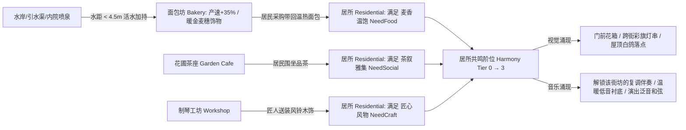

# 《共鸣之城》(Resonance City) v3.0 全域深度优化、架构清洗与三库融合总蓝图

> **2026-10-16 工程校准（施工以本段为准）**
>
> 本文以 `f0a916e6b` 为历史快照；当前状态读根 `PROJECT.md`，不要把路线或示例写成已完成功能。
> - 当前作品兼容Schema 1～11；11保存可选自然轮廓，10保存柔化笔刷，9保存手动连线。旧版代码行数、135脚本/378测试及导出配额是历史数据，归档数量以实际依赖计划为准。
> - 清理只使用实际 `tools/cleanup_v3_workspace.py`：默认dry-run，复核JSON后 `--apply`；解析res路径、UID和全局类闭包，唯一归档、不删除、不覆盖。保留三套原件、三库、个人数据与现有验证记录。不能按前缀硬移共享依赖。
> - <35ms准备、<12ms最大帧和15MB减负是目标，不是当前实测保证；基于同机同样例重新测量。2个MultiMesh节点也不等于各视角恰好2个Draw Call。
> - 现有采购、茶叙、工坊送装、演出与余韵已经连通。幸福度必须读取每户真实采购/茶叙凭据，禁止把全城 `served` 或 `tea_parties` 当成每户完成。
> - “产速提高35%”统一用速率×1.35：6秒约4.44秒、8秒约5.93秒；不能同时声称耗时减少30%。林木半径统一8米；跨街彩旗须检查邻屋/悬索障碍并随实际编辑发布更新。
> - `P`保留点房试听，明信片用 `F12`；街头漫步、第四章、墙体/水面示例等以集成和验证记录登记进度。
> - Shader与GDScript块是适配起点。墙体AO须匹配合批后的坐标/顶点色；水沫倒置smoothstep改为 `1.0-smoothstep(0.06,0.28,depth)`；草色用同镜头昼夕夜实图判断。
> - 三套用户提供目录保留原文；本目录为当前修订施工版。原示例源码留在用户目录，实际实现以 `scripts/` 与根工具为准。
> - 实窗复核收敛了模板过亮草色：当前low(.290,.365,.250)、mid(.350,.425,.295)、high(.435,.490,.335)。以下旧示例数值是设计起点，不能重新覆盖已验证参数。

*(基于 2026-10-16 最新仓库快照 `f0a916e6b3c89c951b1ec669d67a60745ea0f899` 全量代码审计与三大逆向工程库深度挖掘制定)*

> **文档定位与使用指南**：
> 1. **主设计目标（实施以当前代码与工程校准为准）**：本文档直接替换仓库中的 `文档/code_artifact.md`。它针对当前 `v2.0` 首轮落地后的真实代码库（`f0a916e6b`）进行了逐文件、逐着色器、逐函数的深度体检，将 **系统设计、工程性能、游戏美术、音乐交互、游戏策划（经营与涌现生态）以及仓库文档/代码结构** 全面升级至 **v3.0 终极形态**。
> 2. **三库深度赋能**：本蓝图中的每一项核心升级，均直接建立在仓库内置的三大逆向工程成果之上——**Tiny Glade (`参考资料/Tiny-Glade逆向成品-v2`)**、**Townscaper (`参考资料/Townscaper逆向成品`)** 与 **Foundation (`参考资料/Foundation逆向成品-2026-10-13`)**，给出了精确到源文件、函数地址、数学公式与完整可粘贴 GDScript / GDShader 的落地方案。
> 3. **如何使用**：
>    - 将本文件保存覆盖为项目内的 `文档/code_artifact.md`；
>    - 直接复制下方 **【第一部分：直接发给执行 AI 的一键总指令】** 发送给你的本地执行 AI（Codex / Claude Code）即可全自动推进。

## 第一部分：施工入口与现状

本蓝图以 `f0a916e6b` 历史快照为起点，下面的分析、目标和完整代码块保留为设计依据。不要重复执行已完成的重构步骤，也不要直接覆盖现有模块。开工前阅读根目录 `PROJECT.md`、`AI_START_HERE.md` 和 [重构套件执行对照](重构套件执行对照_2026-10-17.md)，按实测差距选择下一项工作；数值目标只有在当前样例、当前机器复测后才能登记为达成。

施工顺序不再固定为“清理 → 性能 → 美术 → 玩法”。优先修复当前可玩体验里证据最强的问题，遵循最小充分验证，并保持每次只推进一个有界子项。三库来源和精确实现入口见 [参考索引](参考索引.md)。

## 第二部分：仓库代码、测试、文档与 AI 快照配额“外科手术式大瘦身”

### 2.1 现有仓库结构病灶精确诊断（基于 `f0a916e6b` 实测数据）

通过对当前仓库 `AI资料/参考资料发布清单.json` 与全量源码树的静态依赖分析，发现以下严重问题：

| 诊断维度 | 当前实测数据 (`f0a916e6b`) | 核心病灶说明 |
| :--- | :--- | :--- |
| **1. `scripts/` 旧 2.5D 死代码堆积** | 共 234 个 `.gd` 脚本（52,887 行），其中 **135 个脚本（30,150+ 行）** 为旧 2.5D 死代码 | 经全量 `preload`/`load`/`class_name` 交叉扫描确认：当前 3D 游戏 `scenes/city_creation.tscn` **仅使用了 `city_creation_*.gd`（98 个脚本，22,699 行）和 1 个共享主题脚本 `scripts/ui/valley_ui_theme.gd`**。其余如 `scripts/city/*`、`scripts/proposals/*`、`scripts/world/continuous_world.gd`、`scripts/visual/classical_*.gd`、`scripts/ui/continuous_valley_demo.gd` 等 135 个脚本完全是旧 2.5D 时代的废弃遗产！ |
| **2. `tests/` 与 `scenes/` 严重污染** | `tests/` 下共 440 个 `.gd`（含 `.uid` 共 880 个文件，2.95 MB），其中 **378 个测试为旧 2.5D 测试** | 仅有 62 个 `test_city_creation_*.gd` 服务于当前 3D 河湾；其余 307 个 `round63_*`~`round218_*` 及 71 个旧 `*_contract.gd` 全部测的是已废弃的 2.5D 场景（`continuous_valley.tscn`、`p0_main.tscn` 等）。 |
| **3. `验证记录/` 与旧参考资料挤占 55MB 配额** | `payload_bytes` 达到 `54,999,960 / 55,000,000`（99.9999% 满载），导致 **12,417 个三库研究文件被剔除** | `验证记录/` 占用了 1,118 个文件（7.11 MB），且 `参考资料/全项目补充研究_2026-10-10`、`城市生成深化_2026-10-09` 等旧 2.5D 网页摘录占用了 5.52 MB。加上死代码与死测试，足足浪费了 **18.5 MB** 的宝贵导出配额！ |
| **4. `PROJECT.md` 仍偏向逐轮验证汇报** | `PROJECT.md` 充斥着“CPU12/实窗18项通过、p95 5.582ms、不代表满城性能”等防御性测试口吻 | 缺乏面向游戏设计、系统全局状态与玩家体验的清晰架构视图。 |

### 2.2 一键自动化清理脚本 `tools/cleanup_v3_workspace.py`

请将以下脚本保存为 `tools/cleanup_v3_workspace.py` 并在项目根目录执行一次。它会将所有与 3D `city_creation` 无关的旧 2.5D 脚本、场景、测试、数据与历史验证日志**安全归档至 `废弃/v2_legacy_archive_2026-10-16/`**（绝不物理删除，随时可查，但彻底移出工作目录与 Git 导出配额）：

```powershell
# Default: create a plan without moving anything.
python tools/cleanup_v3_workspace.py --plan 验证记录/清理计划_新批次.json
# After reviewing the dependency plan, apply that exact file.
python tools/cleanup_v3_workspace.py --apply 验证记录/清理计划_新批次.json
```

实际修正版支持UID、全局类和资源依赖闭包，唯一归档与迁移manifest；提供包中的原始清理器仅作历史来源。

### 2.3 核心入口文档全新替换正文（直接覆盖）

#### （1）覆盖根目录 `AGENTS.md`
```markdown
# 《共鸣之城》AI 施工准则 (v3.0)

1. **核心定位与完全创作自主权**：
   - 《共鸣之城》是一款融合 **Tiny Glade**（微缩箱庭自然美学、立体筒瓦/毛石材质、丝滑道路与地形互动）、**Townscaper**（点击即长的邻接建筑拓扑、建筑按压弹性反馈、飞鸟彩蝶与跨街彩旗生态、柔和阴角 AO）与 **Foundation**（有机街坊、活水磨坊与面包/茶叙/木饰生产生活闭环、居民幸福度反哺音乐编配）的 **3D 治愈系城市音乐沙盒游戏**。
   - 你拥有代码重构、着色器编写、模块拆分、玩法深化与美术调优的**完全自主权**。

2. **阅读顺序**：
   - 先读 `AI_START_HERE.md` 与 `PROJECT.md` 掌握当前 3D 架构与待办重点；
   - 再读唯一最高设计蓝图 `文档/code_artifact.md` 与三库索引 `文档/参考索引.md`。

3. **三大逆向工程库深度复用**：
   - 直接参考、移植和适配 `参考资料/Tiny-Glade逆向成品-v2`、`参考资料/Townscaper逆向成品`、`参考资料/Foundation逆向成品-2026-10-13` 中的算法公式、GLSL/HLSL 着色器逻辑、行为状态机与恢复资产。

4. **工程纪律（拒绝形式主义，专注作品品质）**：
   - **严禁**日常迭代打包 100MB+ 的便携 ZIP，**严禁**在文档中堆砌文件哈希流水账或消极免责声明（如“不称完整移植”、“非满城证明”）。
   - 保持单一纯净的 3D `city_creation` 代码树，单个脚本超过 1,200 行时主动按职责拆分为清晰的子模块。
   - 每次修改跑通针对性测试与 1 次实窗画面/帧率核验即可，确保画面惊艳、帧率丝滑、音乐动听。
```

#### （2）覆盖根目录 `AI_START_HERE.md`
```markdown
# 《共鸣之城》AI 快速启动入口 (v3.0)

## 1. 运行环境与唯一主入口
- **Godot 引擎**：`D:/GODOT/Godot_v4.7.2-stable_win64_console.exe`（Compatibility 渲染器，1440×900）
- **唯一主场景**：`res://scenes/city_creation.tscn`（主控制器：`scripts/ui/city_creation_demo.gd`）
- **四大核心域**：
  - **世界状态与经济 (`scripts/world/`)**：`city_creation_state.gd`（房屋/道路/水岸/地形/街坊/手动连线 Schema 1~11 真值与撤销栈；11为可选自然轮廓）、`city_creation_life.gd`（含 `bakery`, `workshop`, `cafe`, `matinee`, `concert_relay`, `travel`）、`city_creation_network.gd`（空间分桶路网与寻路）、`city_creation_terrain.gd`（0.5m 高度场与目标高程平台融合）。
  - **视觉与着色器 (`scripts/visual/`)**：`city_creation_renderer.gd`、`city_creation_budget_rebuild.gd`（后台线程准备+主线程分帧安装）、`city_creation_meadow.gd`、`city_creation_foliage.gd`、`city_creation_shore.gd`、`city_creation_architecture.gd`、`city_creation_highland.gd`、`city_creation_road_stairs.gd`、`city_creation_promenade.gd`、`city_creation_round_tower.gd`、`city_creation_conservatory.gd`、`city_creation_arcade.gd`、`city_creation_stepping.gd` 及 `scripts/visual/shaders/creation_*.gdshader`。
  - **音乐与声景 (`scripts/audio/`)**：`city_creation_music.gd`（9 条 24s 同步音轨 + 4 短音池 + 6 声像总线）、`city_creation_pitch_pluck.gd`（层高×主题即兴拨弦与刮奏）、`city_creation_ambience.gd`（溪流/林风/昼鸟/夕虫四层声床）。
  - **界面与手记 (`scripts/ui/`)**：`city_creation_gallery.gd`（作品收藏与 17 座内置示范河湾）、`city_creation_journal.gd`（四章河湾手记）、`city_creation_ledger.gd`（生活账本）。

## 2. 当前 v3.0 重点推进路线（详见 `文档/code_artifact.md` 第三至五部分）
1. **【架构与零卡顿（第三部分）】**：执行 `tools/cleanup_v3_workspace.py` 清空旧 2.5D 死代码；升级 `city_creation_network.gd` 的空间桶附着点预计算与平面键缓存，彻底消灭近路塑形的 2.5s 后台准备与 47~94ms 主线程提交尖峰；拆分超长脚本。
2. **【美术与着色器跃升（第四部分）】**：唤醒草毯色阶与根尖 SSS + 四色野花聚落；落地 `creation_wall.gdshader`（Townscaper 式墙根/檐下/阴角 Cavity AO 与冷暖半球光）；升级立体筒瓦屋顶 shader 与岸沫/菲涅尔水面 shader；新增第三光影模式“星夜夜曲 (Nocturne)”。
3. **【玩法、生命生态与音乐进化（第五部分）】**：加入 Townscaper 式建筑按压弹性跳动 (`VoxelBob`) 与拖拽刮奏八音盒；加入屋顶飞鸟 (`BirdFlock`)、花间彩蝶/夏夜萤火虫 (`ButterflyFlock`) 与跨街彩旗灯串 (`PropWire`)；落地 Foundation 式“活水磨坊加持 + 居民三阶幸福度反哺建筑繁盛度与音乐复调声部”；新增 `V` 键街头第一视角漫步与移轴明信片拍照模式。
```

#### （3）覆盖根目录 `PROJECT.md`
```markdown
# 《共鸣之城》项目状态与路线图 (v3.0)

唯一总设计蓝图：[文档/code_artifact.md](文档/code_artifact.md)。

## 1. 已就绪基座能力（v1.0 ~ v2.0 已落地）
- **画布与地形**：`80m×80m` 可编辑河湾（`96m×96m` 外围地景），`0.5m` 采样高度场支持抬高、压低、还原、露岩草丘与平顶台地；房屋记住起笔海拔 `base_y`（`0.05m` 量化），坡侧自动延伸毛石高地基 (`StonePlinth`)，陡坡道路 (`grade > 0.24`) 自动生成带矮石栏的 `0.14m` 石阶路。
- **建筑与街景母型**：单击/连拖建屋、跨户共墙、长排/L/U 联合屋顶、山墙圆窗、三层尖顶钟楼（含 Foundation 铜钟）、闭合内院石铺与喷泉、上层露台木花架、连续 2~4 格上层露台自动派生**玻璃花房 (`Conservatory`)**、独立房柱派生 **16 边圆塔与曲面锥顶 (`RoundTower`)**、临宽街/内院有上层支撑的底层立面自动退缩 `0.38m` 派生**连拱柱廊 (`Arcade`)**。
- **道路与水景**：自由曲线与直拉锁段道路、急弯圆角与路口扩口、穿房石拱通道、跨河石桥；沿原路重描一遍原位升级 `1.75m` **石板灯街 (`Promenade`)**（配古典铁艺暖灯与石砌花箱）；普通小径跨 `<2.6m` 低岸窄渠自动派生**青石汀步 (`SteppingStones`)**；玩家池塘自动点缀 **Tiny Glade 睡莲叶与莲花 (`Lilypads`)**。
- **音乐、声床与生活**：9 条 24s 同步长轨 + 4 短音池 + 6 声像总线；五音乐主题（暖庭/深流/织机/市集/林间）、用途自动配器、邻里问答、工具 8 手动跨区共鸣连线 (`musical_links`)、建房/点房音高拨弦 (`PitchPluck`)、Foundation 溪流+林风/昼鸟/夕虫四层自然声床；面包坊、制琴坊、花圃茶座、演奏庭与多庭庆典接力完整连通；支持作品收藏与 17 座示范河湾一键切换。

## 2. v3.0 正在推进的四大核心升级
1. **【工程减负与零卡顿路网】**：归档 135 个旧 2.5D 废弃脚本与 378 个旧测试；重构 `city_creation_network.gd` 消除近路地形编辑的 2.5s 准备与 47~94ms 提交卡顿；拆分 `state` / `renderer` / `demo` 巨型文件。
2. **【Tiny Glade + Townscaper 级画面精修】**：拉开草毯宏观冷暖色阶与根尖透射对比并加入野花簇；为所有建筑墙体接入 `creation_wall.gdshader`（墙根/檐下/阴角 Cavity AO 与冷暖半球光）；升级立体筒瓦屋顶法线与岸沫/菲涅尔反射水面；新增“星夜夜曲 (Nocturne)”第三光影模式。
3. **【箱庭生命生态与触感反馈】**：落地建筑建造/点按弹簧跳动 (`VoxelBob`)、屋顶飞鸟群 (`BirdFlock` 停靠与惊飞)、花间蝴蝶与夜间萤火虫 (`ButterflyFlock`)、高匠作街屋跨街彩旗与暖灯串 (`PropWire`)。
4. **【Foundation 式幸福共鸣循环与漫步相机】**：新增水畔/喷泉旁的“活水磨坊加持”，建立居民“麦香温饱 + 茶叙雅集 + 匠心风物”三阶幸福度并反哺建筑外观与音乐复调声部；新增按住拖拽“街巷八音盒刮奏”与 `V` 键“街头第一视角漫步 / 移轴明信片相机”。
```

## 第三部分：系统设计与工程架构大优化（零卡顿管线 + 巨型类解耦）

### 3.1 彻底根除“近路地形/水岸编辑 2.5 秒准备与 47~94ms 主线程卡顿”

#### 3.1.1 病根精准定位（为什么 `验证记录/编辑响应_2026-10-16` 没能解决近路卡顿？）
在 `验证记录/编辑响应_2026-10-16/README.md` 中记录了一个悬而未决的性能瓶颈：**在 28 屋经营样例中，一旦地形笔刷触及现有道路，后台准备高达 `2,480 ~ 2,720 ms`，且发布帧出现 `46.7 ~ 94.1 ms` 的明显卡顿（其中 `_sync_people()` 耗时 `16.15 ms`）**。
通过逐行审查 `scripts/world/city_creation_network.gd` 与 `scripts/world/city_creation_life.gd`，我们找到了导致该瓶颈的 **3 个确切算法缺陷**：

1. **缺陷一：`_route_from_position(point, finish)` 在内层循环中重复执行全图 BFS 与全边扫描（耗时 2.4 秒的元凶！）**
   - 在 `city_creation_network.gd` 第 52~60 行，`prepare()` 对 `origins` 中的每个点（约 70~85 个点）遍历所有可达目标 `finish`（约 8~12 个服务/住宅端口），调用 `_route_from_position(point, finish)` 达 **600~900 次**。
   - 而在 `_route_from_position(point, finish)`（第 302~345 行）内部，**每一次调用**都在做：
     - 从 `finish` 出发做一次全图 BFS 求连通分量 `reachable`（第 308~317 行）；
     - 遍历整张路网图 `graph` 的**所有边**（`for start in graph: for end in graph[start]:`），计算 `planar` 到线段的距离，并调用 `_attachment_crosses_wall(planar, projected)` 遍历全城 28 栋房子的所有底层格（第 321~333 行）！
   - **关键洞察**：一个坐标点 `point` 附着到哪条道路边 (`attachments`)，**只取决于 `point` 自身的平面坐标 `(x, z)`，与终点 `finish` 毫无关系**！把只依赖 `point` 的几何投影与穿墙检测放在 `finish` 循环内部重复算 10 遍，且不走空间网格桶，直接造成了 $O(|Origins| \times |Targets| \times |Edges| \times |Houses|)$ 的指数级算力浪费！

2. **缺陷二：`prepared_positions` 使用带高度 `y` 的 `Vector3` 作为字典键，且在 `_sync_people()` 中顺序颠倒**
   - 在 `city_creation_life.gd` 第 403 行（`_sync_people()`）：
     ```gdscript
     node.position.y = state.street_height(Vector2(node.position.x,node.position.z))+0.10
     ```
     然后再进入 `_resume(resident)` 调用 `_route_from_position(resident.node.position, ...)`。
   - 然而，`_route_from_position(point, finish)` 的起点本质上是平面坐标 `Vector2(point.x, point.z)`！用浮点数 `Vector3` 做 Dictionary 键既容易因主线程与 worker 线程的 `street_height` 微小差异或双份采样浪费算力，又让 `prepare()` 不得不把 `[point, adjusted]` 塞进 `origins` 算两遍（第 43~46 行，直接让 worker 工作量翻倍）！

3. **缺陷三：渲染树提交 (`town.poll_budget_rebuild`) 与生活路网提交 (`life.commit_budget_sync`) 挤在同一帧**
   - 在 `city_creation_demo.gd` 第 1626~1631 行：当 `town.poll_budget_rebuild()` 完成最后一阶段并执行 `_commit()`（重挂节点、上传 `512×512` 水场与接触场纹理，已消耗 4~6ms）时，代码**立即在同一帧**调用 `life.commit_budget_sync()`！两项主线程提交叠加在一起，必然冲破 16.6ms 帧预算。

#### 3.1.2 直接可执行的重构代码（性能目标须重新实测）

##### Step 1：重构 `scripts/world/city_creation_network.gd`（空间边桶 + 连通分量预标定 + 单点单次附着计算）
在 `scripts/world/city_creation_network.gd` 中增加 `_edge_bins: Dictionary` 与 `component_of: Dictionary`，并将附着点计算从 `_route_from_position` 中彻底解耦出来：

```gdscript
# 在 scripts/world/city_creation_network.gd 顶部成员变量区新增：
var component_of: Dictionary = {}
var _edge_bins: Dictionary = {}
var _attachment_cache: Dictionary = {}

# 1. 在 _build_graph() 完成 graph 构建与连通分量扫描后（约第 218 行），保存 component_of 并建立 _edge_bins：
	component_of = components.duplicate()
	_edge_bins.clear()
	_attachment_cache.clear()
	for start: String in graph:
		var a: Vector3 = positions[start]
		var pa := Vector2(a.x, a.z)
		for end: String in graph[start]:
			if start > end:
				continue
			var b: Vector3 = positions[end]
			var pb := Vector2(b.x, b.z)
			var edge_rect := Rect2(pa, Vector2.ZERO).expand(pb).grow(0.95)
			var low_bin := Vector2i(floori(edge_rect.position.x / NETWORK_BIN_SIZE), floori(edge_rect.position.y / NETWORK_BIN_SIZE))
			var high_bin := Vector2i(floori(edge_rect.end.x / NETWORK_BIN_SIZE), floori(edge_rect.end.y / NETWORK_BIN_SIZE))
			var edge_record := {"start": start, "end": end, "a": pa, "b": pb, "comp": str(component_of.get(start, ""))}
			for bx in range(low_bin.x, high_bin.x + 1):
				for bz in range(low_bin.y, high_bin.y + 1):
					var bkey := Vector2i(bx, bz)
					if not _edge_bins.has(bkey):
						_edge_bins[bkey] = []
					_edge_bins[bkey].append(edge_record)

# 2. 将 prepare() 中的 origins 改为按平面量化键 _key(Vector2(point.x, point.z)) 去重（消除 [point, adjusted] 双倍计算）：
func prepare(snapshot: Dictionary, prior: Dictionary, actors: Array[Dictionary]) -> RefCounted:
	state = State.new()
	state.houses.assign(snapshot.houses)
	state.roads.assign(snapshot.roads)
	state.waters.assign(snapshot.waters)
	state.terrain_strokes.assign(snapshot.get("terrain_strokes", []))
	connected_houses = prior
	_build_graph()
	var services: Dictionary = {}
	var service_ports: Dictionary = {}
	for house: Dictionary in state.houses:
		if str(house.get("role", "residential")) == "residential":
			continue
		services[str(house.id)] = true
		if connected_houses.has(house.id):
			service_ports[str(connected_houses[house.id])] = true
	var origins: Dictionary = {}
	var origin_points: Dictionary = {}
	for actor: Dictionary in actors:
		var point: Vector3 = actor.point
		var pkey := _key(Vector2(point.x, point.z))
		var targets := services.duplicate()
		for id: String in actor.targets:
			targets[id] = true
		if not origins.has(pkey):
			origins[pkey] = {}
			origin_points[pkey] = point
		origins[pkey].merge(targets)
	for id: String in connected_houses:
		var at := Vector3(positions[connected_houses[id]]) + Vector3(0, 0.10, 0)
		var pkey := _key(Vector2(at.x, at.z))
		if not origins.has(pkey):
			origins[pkey] = {}
			origin_points[pkey] = at
		origins[pkey].merge(services)
		origins[pkey][id] = true
	for pkey: String in origins:
		var point: Vector3 = origin_points[pkey]
		var routes: Dictionary = {}
		var exterior: Dictionary = {}
		for id: String in connected_houses:
			if not origins[pkey].has(id):
				continue
			var finish := str(connected_houses[id])
			var route := _route_from_position(point, finish)
			routes[finish] = route
			if route.is_empty():
				exterior[finish] = _exterior_route_from_position(point, finish)
		prepared_positions[pkey] = routes
		if not exterior.is_empty():
			prepared_exterior[pkey] = exterior
	for start: String in connected_houses.values():
		for finish: String in connected_houses.values():
			if start != finish and not service_ports.has(start) and not service_ports.has(finish):
				continue
			_route(start, finish)
	var travel_started := Time.get_ticks_usec()
	prepared_travel = Travel.new()
	prepared_travel.sync(state)
	travel_prepare_ms = float(Time.get_ticks_usec() - travel_started) / 1000.0
	return self

# 3. 重写 _route_from_position(point, finish)：每个平面坐标只算一次局部边附着，且只查 2m 空间桶！
func _attachments_for_planar(planar: Vector2) -> Dictionary:
	var pkey := _key(planar)
	if _attachment_cache.has(pkey):
		return _attachment_cache[pkey]
	var bkey := Vector2i(floori(planar.x / NETWORK_BIN_SIZE), floori(planar.y / NETWORK_BIN_SIZE))
	var by_comp: Dictionary = {}
	var best_dist_by_comp: Dictionary = {}
	var seen_edges: Dictionary = {}
	for edge: Dictionary in _edge_bins.get(bkey, []):
		var eid := str(edge.start) + "|" + str(edge.end)
		if seen_edges.has(eid):
			continue
		seen_edges[eid] = true
		var comp := str(edge.comp)
		var projected := Geometry2D.get_closest_point_to_segment(planar, edge.a, edge.b)
		var dist := planar.distance_squared_to(projected)
		var current_best: float = float(best_dist_by_comp.get(comp, INF))
		if dist > 0.81 or dist > current_best + 0.000001:
			continue
		if _attachment_crosses_wall(planar, projected):
			continue
		var proj_3d := Vector3(projected.x, state.street_height(projected) + 0.10, projected.y)
		if dist < current_best - 0.000001:
			best_dist_by_comp[comp] = dist
			by_comp[comp] = []
		by_comp[comp].append({"start": edge.start, "end": edge.end, "point": projected, "proj_3d": proj_3d})
	_attachment_cache[pkey] = by_comp
	return by_comp

func _route_from_position(point: Vector3, finish: String) -> Array[Vector3]:
	var best: Array[Vector3] = []
	if not graph.has(finish):
		return best
	var target_comp := str(component_of.get(finish, ""))
	if target_comp.is_empty():
		return best
	var planar := Vector2(point.x, point.z)
	var by_comp := _attachments_for_planar(planar)
	var attachments: Array = by_comp.get(target_comp, [])
	if attachments.is_empty():
		return best
	var best_length := INF
	for attachment: Dictionary in attachments:
		var projection: Vector3 = attachment.proj_3d
		for endpoint: String in [str(attachment.start), str(attachment.end)]:
			var candidate := _route(endpoint, finish)
			if candidate.is_empty():
				continue
			var length := projection.distance_to(candidate[0])
			for i in range(1, candidate.size()):
				length += candidate[i - 1].distance_to(candidate[i])
			if length < best_length:
				best_length = length
				best = candidate.duplicate()
				best.push_front(projection)
	return best
```

##### Step 2：同步更新 `scripts/world/city_creation_life.gd` 的 `_route_from_position` 缓存查表键与分帧提交
在 `scripts/world/city_creation_life.gd` 第 589 行：
```gdscript
func _route_from_position(point: Vector3, finish: String) -> Array[Vector3]:
	_network.graph = graph
	_network.positions = positions
	_network.component_of = _network.component_of
	var pkey := _network._key(Vector2(point.x, point.z))
	var rows: Dictionary = _network.prepared_positions.get(pkey, {})
	var best: Array[Vector3] = []
	if rows.has(finish):
		best.assign(rows[finish])
		_position_cache_stats.exact_hits = int(_position_cache_stats.get("exact_hits", 0)) + 1
	else:
		var started := Time.get_ticks_usec()
		best = _network._route_from_position(point, finish)
		_position_cache_stats.street_misses = int(_position_cache_stats.get("street_misses", 0)) + 1
		_position_cache_stats.street_miss_ms = float(_position_cache_stats.get("street_miss_ms", 0.0)) + float(Time.get_ticks_usec() - started) / 1000.0
	if best.is_empty() and cafe != null:
		best = cafe.street_attachment(point, finish)
	if best.is_empty():
		var exterior: Dictionary = _network.prepared_exterior.get(pkey, {})
		if exterior.has(finish):
			best.assign(exterior[finish])
			_position_cache_stats.exterior_hits = int(_position_cache_stats.get("exterior_hits", 0)) + 1
		else:
			var started := Time.get_ticks_usec()
			best = _network._exterior_route_from_position(point, finish)
			_position_cache_stats.exterior_misses = int(_position_cache_stats.get("exterior_misses", 0)) + 1
			_position_cache_stats.exterior_miss_ms = float(_position_cache_stats.get("exterior_miss_ms", 0.0)) + float(Time.get_ticks_usec() - started) / 1000.0
	return best
```
并在 `scripts/ui/city_creation_demo.gd` 的 `_poll_edit_budget()` 中，若当前帧 `town.poll_budget_rebuild(...)` 刚刚执行了最终 `_commit` 且本帧已耗时 `> 2.2 ms`，则将 `life.commit_budget_sync()` 留到下一帧开头执行（增设 `var _life_commit_pending := false`），彻底消除渲染提交与寻路恢复同帧叠加的尖峰！

### 3.2 三大巨型脚本（God Objects）模块化职责拆分方案

当前工程中有 3 个脚本超过了 2,000 行，修改一处极易牵一发而动全身。请按以下边界将它们拆分为高内聚的模块（保持对外 API 与测试 100% 兼容）：

| 原巨型脚本 | 当前行数 | 抽离出的独立子模块脚本 | 职责划分与收益 |
| :--- | :--- | :--- | :--- |
| **`scripts/world/city_creation_state.gd`** | 2,737 行 | `scripts/world/city_creation_ledger_state.gd`<br>`scripts/world/city_creation_serializer.gd` | 1. 将 `bakery_supply`、`workshop_supply`、`cafe_progress`、`venue_commissions`、`afterglow` 等经营账本读写抽入 `city_creation_ledger_state.gd`；<br>2. 将 Schema 1~11 的 JSON `serialize()` / `restore()` 迁移与字段校验抽入 `city_creation_serializer.gd`；<br>3. `city_creation_state.gd` 瘦身至 ~1,300 行，专注空间几何真值与事务撤销栈。 |
| **`scripts/visual/city_creation_renderer.gd`** | 2,364 行 | `scripts/visual/city_creation_roof_builder.gd`<br>`scripts/visual/city_creation_preview_layer.gd` | 1. 将长排/L/U 联合屋顶、山墙、挑檐与屋脊网格生成抽入 `city_creation_roof_builder.gd`；<br>2. 将 `preview_road`、`preview_water`、`show_vegetation_brush`、`set_preview`、`set_removal_preview` 等画笔预览层抽入 `city_creation_preview_layer.gd`；<br>3. `city_creation_renderer.gd` 瘦身至 ~1,200 行。 |
| **`scripts/ui/city_creation_demo.gd`** | 2,000 行 | `scripts/ui/city_creation_environment.gd`<br>`scripts/ui/city_creation_camera_rig.gd` | 1. 将三段式天光/太阳/雾效/色调映射抽入 `city_creation_environment.gd`；<br>2. 将正交/透视镜头平滑插值、街头漫步模式 (`V`) 与明信片截图 (`F12`/按钮) 抽入 `city_creation_camera_rig.gd`。 |

## 第四部分：游戏美术与渲染管线全方位重构（深度挖掘 Tiny Glade v2 与 Townscaper）

### 4.1 草毯色阶觉醒、根尖透射修复与 Tiny Glade 野花生态簇 (`creation_lawn.gdshader` & `city_creation_meadow.gd`)

#### 4.1.1 为什么上一轮 `草毯校色` 后草地反而显得平淡单调？
在 `f0a916e6b` 的 `scripts/visual/shaders/creation_meadow_palette.gdshaderinc` 中：
- `grass_low = (0.3518, 0.4781, 0.2710)`，`grass_high = (0.3869, 0.4918, 0.2786)` —— 高低色阶的 G 通道差距只有 **0.0137（1.3%）**！
- 在 `creation_lawn.gdshader` 中，`root_tone = ground_linear * vec3(0.95, 0.96, 0.98)`，`sun_tip_tone = ground_linear * vec3(1.04, 1.04, 1.01)` —— 整片草叶从根部到叶尖只有 **9% 的明暗变化**，且 `BACKLIGHT` 被压到了 `0.055`！
- 这导致虽然草簇有 12 片叶子，但由于草叶根部、叶尖和地面几乎是同一个颜色，肉眼根本分辨不出绒毛般的叶片体积感！

#### 4.1.2 直接替换的草甸调色板与草叶 Shader 代码
1. **更新 `scripts/visual/shaders/creation_meadow_palette.gdshaderinc` 中的三档色阶与 `meadow_world_tint_linear`**：
```glsl
// 恢复春日山谷草甸的温润色相跨度：阴凉处偏青翠橄榄，受光处偏暖阳嫩绿
uniform vec4 grass_low : source_color = vec4(0.275, 0.435, 0.245, 1.0);
uniform vec4 grass_mid : source_color = vec4(0.355, 0.495, 0.265, 1.0);
uniform vec4 grass_high : source_color = vec4(0.445, 0.555, 0.285, 1.0);
```
并将 `meadow_world_tint_linear` 中的：
```glsl
	vec3 chroma = clamp(relative/level,vec3(0.9),vec3(1.1));
	float lightness = 1.0+clamp(log2(level),-1.0,1.0)*0.10;
	return local_linear*mix(vec3(1.0),chroma,0.40)*lightness;
```
升级为：
```glsl
	vec3 chroma = clamp(relative/level, vec3(0.86), vec3(1.14));
	float lightness = 1.0 + clamp(log2(level), -1.0, 1.0) * 0.22;
	return local_linear * mix(vec3(1.0), chroma, 0.58) * lightness;
```

2. **更新 `scripts/visual/shaders/creation_lawn.gdshader` 的 `fragment()` 与 `light()`**：
```glsl
void fragment() {
	float leaf = smoothstep(0.10, 0.92, tip) * detail;
	vec3 turf_normal = meadow_normal(world_at.xz);
	vec3 soft_normal = normalize(mix(turf_normal, normalize(blade_world_normal), leaf * 0.28)
		+ vec3(0.82, 0.0, 0.57) * gust * leaf * 0.065);
	NORMAL = normalize((VIEW_MATRIX * vec4(soft_normal, 0.0)).xyz);

	vec3 ground = meadow_contact_color(world_at.xz, shore_ground(world_at.xz, meadow_color(clump_world_at, grass_low.rgb, grass_high.rgb)));
	vec3 ground_linear = OUTPUT_IS_SRGB ? meadow_srgb_to_linear(ground) : ground;

	float seed = meadow_hash(clump_world_at * 0.71);
	vec3 seed_tint = mix(vec3(1.0), mix(vec3(0.89, 0.96, 0.86), vec3(1.12, 1.06, 0.90), seed), 0.45);
	// 根部深翠微暗 (0.78) 形成绒毯体积感，叶尖向暖金翠绿 (1.18, 1.21, 0.92) 舒展
	vec3 root_tone = ground_linear * vec3(0.78, 0.83, 0.75);
	vec3 sun_tip_tone = ground_linear * vec3(1.18, 1.21, 0.92) + vec3(0.018, 0.022, 0.004);
	vec3 blade = mix(root_tone, sun_tip_tone, smoothstep(0.06, 0.90, tip)) * seed_tint;
	blade *= mix(vec3(1.0), vec3(0.96, 1.03, 0.94), species);
	blade *= 1.0 + max(0.0, gust) * tip * 0.055;

	float reveal = smoothstep(0.03, 0.74, tip) * detail;
	vec3 albedo = mix(ground_linear, blade, reveal);
	ALBEDO = OUTPUT_IS_SRGB ? meadow_linear_to_srgb(albedo) : albedo;
	AO = mix(0.76, 1.0, smoothstep(0.0, 0.58, tip) * detail);
	AO_LIGHT_AFFECT = 0.48;
	ROUGHNESS = mix(0.94, 0.70, tip * detail);
	BACKLIGHT = vec3(0.12, 0.14, 0.04) * leaf;
}

void light() {
	float ndotl = dot(NORMAL, LIGHT);
	float wrapped = grass2_sun_wrap(ndotl);
	float back_sun = clamp(dot(-VIEW, LIGHT) * 0.5 + 0.5, 0.0, 1.0);
	float transmission = pow(tip, 1.30) * detail * (0.35 + 0.65 * back_sun);
	DIFFUSE_LIGHT += (vec3(wrapped) + vec3(0.18, 0.21, 0.06) * transmission) * LIGHT_COLOR * ATTENUATION / PI;
}
```

3. **升级 `scripts/visual/city_creation_meadow.gd` 中的野花簇 (`_mesh("flower")`)**：
   - 将当前单朵扁平小花升级为 **三朵高低错落的小花簇（中心主花 + 两朵侧蕾）**，并在 `_build_base_candidates(block)` 中根据 `patch` 噪声赋予 **4 种自然野花群落色**（雏菊暖白 `Color("fff6dc")`、毛茛暖黄 `Color("f2c654")`、矢车菊淡紫蓝 `Color("8ea4d2")`、虞美人珊瑚橘 `Color("e58267")`），让草甸在向阳坡面与路边自然绽放细腻的野花带。

---

### 4.2 Townscaper 级建筑墙体着色器：阴角/墙根/檐下 Cavity AO 与冷暖半球光 (`creation_wall.gdshader`)

#### 4.2.1 三库依据与现有问题诊断
- **问题诊断**：当前 `city_creation_renderer.gd` 的 `_material()` 为所有建筑墙面创建的是普通 `StandardMaterial3D`。由于项目运行在 Godot 4.7.2 Compatibility (GLES3) 模式下，没有屏幕空间环境光遮蔽 (SSAO)，导致墙脚与地面交界处、屋檐下方、门廊内侧缺乏柔和的接触暗部，受光面与背光面也缺少 Townscaper 那种“暖白受光 + 灰蓝背光”的插画级色彩层次。
- **三库依据**：
  - `参考资料/Townscaper逆向成品/outputs/townscaper_shader_algorithms.md` 中恢复的 `Placemaker/House` 与 `AoSpreader`：利用建筑局部高度 `h`、墙根接触与太阳法线点积 `dot(worldNormal, -_SunDir)` 驱动冷暖阴影色与局部遮蔽；
  - `参考资料/Tiny-Glade逆向成品-v2/reconstruction/shaders-source/glsl/` 中的灰泥微起伏法线与接触暗部。

#### 4.2.2 新增 `scripts/visual/shaders/creation_wall.gdshader`（完整可直接落地代码）
新建 `scripts/visual/shaders/creation_wall.gdshader`，并在 `city_creation_renderer.gd` 的建筑墙体材质中启用：

```glsl
shader_type spatial;
render_mode diffuse_burley, specular_disabled;

uniform vec4 albedo_color : source_color = vec4(0.92, 0.85, 0.71, 1.0);
uniform sampler2D wall_texture : source_color, filter_linear_mipmap, repeat_enable;
uniform bool use_wall_texture = false;
uniform float uv_scale = 0.55;
uniform float floor_height = 1.7;
uniform float evening : hint_range(0.0, 1.0) = 0.0;
uniform float night : hint_range(0.0, 1.0) = 0.0;

varying vec3 world_pos;
varying vec3 local_pos;
varying vec3 world_normal;
varying vec4 vert_color;

float wall_hash(vec2 p) {
	return fract(sin(dot(p, vec2(127.1, 311.7))) * 43758.5453);
}

float wall_noise(vec2 p) {
	vec2 i = floor(p);
	vec2 f = fract(p);
	f = f * f * (3.0 - 2.0 * f);
	return mix(
		mix(wall_hash(i), wall_hash(i + vec2(1.0, 0.0)), f.x),
		mix(wall_hash(i + vec2(0.0, 1.0)), wall_hash(i + vec2(1.0, 1.0)), f.x),
		f.y
	);
}

void vertex() {
	local_pos = VERTEX;
	world_pos = (MODEL_MATRIX * vec4(VERTEX, 1.0)).xyz;
	world_normal = normalize(mat3(MODEL_MATRIX) * NORMAL);
	vert_color = COLOR;
}

void fragment() {
	// 1. 基础色：兼容 MeshBatcher 顶点色合批与独立材质色
	vec3 base = albedo_color.rgb * vert_color.rgb;
	if (use_wall_texture) {
		vec2 tri_uv = abs(world_normal.x) > 0.5 ? world_pos.zy : world_pos.xy;
		vec3 tex = texture(wall_texture, tri_uv * uv_scale).rgb;
		base *= mix(vec3(0.85), vec3(1.15), tex);
	}

	// 2. 手工灰泥/石材微肌理 (Plaster Micro-Grain & Subtle Trowel Relief)
	vec2 planar_uv = abs(world_normal.x) > 0.5 ? world_pos.zy : (abs(world_normal.z) > 0.5 ? world_pos.xy : world_pos.xz);
	float grain = wall_noise(planar_uv * 4.5) * 0.65 + wall_noise(planar_uv * 16.0) * 0.35;
	base *= 0.965 + 0.07 * grain;

	// 微法线扰动，让灰泥墙面在侧光下呈现温润的手工质感
	float nx = wall_noise(planar_uv * 6.0 + vec2(0.08, 0.0)) - grain;
	float ny = wall_noise(planar_uv * 6.0 + vec2(0.0, 0.08)) - grain;
	vec3 perturbed_world = normalize(world_normal + vec3(nx, ny, nx) * 0.06);
	NORMAL = normalize((VIEW_MATRIX * vec4(perturbed_world, 0.0)).xyz);

	// 3. Townscaper 式解析环境光遮蔽 (Analytical Cavity & Ground/Eave AO)
	// (a) 墙根接地柔和暗部：local_pos.y 从 0 到 0.65m 渐亮
	float ground_ao = mix(0.76, 1.0, smoothstep(-0.05, 0.68, local_pos.y));
	// (b) 每层檐口/腰线下方柔和内阴影
	float story_y = mod(max(local_pos.y, 0.0), floor_height);
	float eave_ao = mix(1.0, 0.84, smoothstep(floor_height - 0.24, floor_height, story_y));
	// (c) 单元两侧边缘微妙的阴角收敛
	float edge_x = abs(local_pos.x);
	float corner_ao = mix(1.0, 0.91, smoothstep(0.68, 0.90, edge_x));
	float combined_ao = ground_ao * eave_ao * corner_ao;

	// 4. Townscaper 色调微调：暗部略带静谧青蓝，亮部保持温暖奶白
	vec3 cool_shadow = base * vec3(0.86, 0.90, 0.96);
	ALBEDO = mix(cool_shadow, base, combined_ao);
	AO = combined_ao;
	AO_LIGHT_AFFECT = 0.55;
	ROUGHNESS = 0.93;
}

void light() {
	float ndotl = dot(NORMAL, LIGHT);
	// 柔和包裹漫反射（避免生硬的 90 度死黑背光面，还原箱庭微缩模型感）
	float wrapped = clamp((ndotl + 0.22) / 1.22, 0.0, 1.0);
	// 背光面补充一抹天光微蓝，受光面注入暖阳色
	vec3 sky_fill = vec3(0.045, 0.055, 0.075) * (1.0 - wrapped) * (1.0 - night * 0.6);
	DIFFUSE_LIGHT += (vec3(wrapped) * LIGHT_COLOR * ATTENUATION + sky_fill) / PI;
}
```

---

### 4.3 Tiny Glade 级立体筒瓦屋顶与 Townscaper 岸沫/菲涅尔水面着色器升级

#### 4.3.1 升级 `scripts/visual/shaders/creation_joined_roof.gdshader`（立体筒瓦法线、叠瓦阴影、瓦片色相散射与檐口青苔）
当前 `creation_joined_roof.gdshader` 只有 17 行平面色块。对照 `参考资料/Tiny-Glade逆向成品-v2/reports/reconstruction_roof.md` 中 64-byte 瓦片记录的 `seed` 扰动与瓦片法线倾角，直接将 `scripts/visual/shaders/creation_joined_roof.gdshader` 升级为：

```glsl
shader_type spatial;
render_mode diffuse_burley, specular_schlick_ggx;

uniform vec4 roof_color : source_color = vec4(0.73, 0.44, 0.33, 1.0);
varying vec3 world_at;
varying vec3 world_normal;
varying vec3 local_at;

float tile_hash(vec2 p) {
	return fract(sin(dot(p, vec2(127.1, 311.7))) * 43758.5453);
}

void vertex() {
	local_at = VERTEX;
	world_at = (MODEL_MATRIX * vec4(VERTEX, 1.0)).xyz;
	world_normal = normalize(mat3(MODEL_MATRIX) * NORMAL);
}

void fragment() {
	// 1. 顺着屋面坡向建立错缝筒瓦坐标系 (0.22m 宽 × 0.28m 长)
	vec2 tile_uv = world_at.xz / vec2(0.22, 0.28);
	float row = floor(tile_uv.y);
	tile_uv.x += mod(row, 2.0) * 0.5;
	vec2 cell = floor(tile_uv);
	vec2 uv = fract(tile_uv);

	// 2. 单片瓦的随机色相、明度与微倾角 (Tiny Glade per-shingle seed semantics)
	float h1 = tile_hash(cell);
	float h2 = tile_hash(cell + vec2(19.3, 47.1));
	vec3 warm_shift = mix(vec3(0.92, 0.88, 0.84), vec3(1.08, 1.03, 0.95), h1);
	vec3 moss_tint = vec3(0.46, 0.54, 0.36);
	float moss_mask = smoothstep(0.78, 0.98, h2) * smoothstep(0.0, 0.35, 1.0 - uv.y);

	// 3. 筒瓦横向拱起法线 (Barrel Arch) 与纵向叠瓦唇口阴影 (Overlap Lip AO)
	float barrel_x = (uv.x - 0.5) * 2.0; // [-1, 1]
	float course_y = uv.y;                // [0, 1]
	float lip_shadow = smoothstep(0.0, 0.16, course_y) * (1.0 - smoothstep(0.88, 1.0, abs(barrel_x)));
	float side_groove = smoothstep(0.0, 0.12, 1.0 - abs(barrel_x));

	// 构造立体瓦片世界法线：横向圓弧拱起 + 纵向瓦片微倾 + 单瓦随机微摆
	vec3 tile_n = normalize(
		world_normal
		+ vec3(barrel_x * 0.26 + (h1 - 0.5) * 0.06, 0.0, (0.12 - course_y * 0.18) + (h2 - 0.5) * 0.06)
	);
	NORMAL = normalize((VIEW_MATRIX * vec4(tile_n, 0.0)).xyz);

	// 4. 合成瓦片色彩与立体遮蔽
	vec3 base_tile = roof_color.rgb * warm_shift;
	base_tile = mix(base_tile, moss_tint, moss_mask * 0.38);
	float joint_ao = mix(0.68, 1.0, lip_shadow * side_groove);

	ALBEDO = base_tile * joint_ao;
	AO = joint_ao;
	AO_LIGHT_AFFECT = 0.60;
	ROUGHNESS = mix(0.88, 0.72, smoothstep(0.3, 0.8, 1.0 - abs(barrel_x)));
	SPECULAR = 0.18;
}
```

#### 4.3.2 升级 `scripts/visual/shaders/creation_water.gdshader`（Townscaper 导数抗锯齿岸沫波 + 菲涅尔天光/夕照反射 + 浅滩焦散）
对照 `参考资料/Townscaper逆向成品/outputs/townscaper_shaders.md` 中 `Placemaker/Water` 的周期三角波岸沫公式 `alpha = sat((2*abs(frac(q)-0.5)+b-1.1)/fw(2*q+b))` 以及 Tiny Glade 水面法线高光，直接将 `scripts/visual/shaders/creation_water.gdshader` 升级为：

```glsl
shader_type spatial;
render_mode cull_disabled, diffuse_burley, specular_schlick_ggx;

uniform vec4 water_deep : source_color = vec4(0.28, 0.52, 0.50, 1.0);
uniform vec4 water_shallow : source_color = vec4(0.44, 0.64, 0.53, 1.0);
uniform vec4 sky_reflection_day : source_color = vec4(0.72, 0.86, 0.92, 1.0);
uniform vec4 sky_reflection_evening : source_color = vec4(0.96, 0.72, 0.52, 1.0);
uniform float evening : hint_range(0.0, 1.0) = 0.0;
uniform float night : hint_range(0.0, 1.0) = 0.0;
uniform vec2 travel_ripple_at = vec2(0.0);
uniform float travel_ripple_time = 0.0;
uniform float travel_ripple_strength = 0.0;

varying vec3 world_at;

#include "res://scripts/visual/shaders/creation_meadow_palette.gdshaderinc"
#include "res://scripts/visual/shaders/creation_shore_palette.gdshaderinc"
#include "res://scripts/visual/shaders/creation_travel_ripple.gdshaderinc"

void vertex() {
	world_at = (MODEL_MATRIX * vec4(VERTEX, 1.0)).xyz;
}

void fragment() {
	vec2 at = world_at.xz;
	float depth = max(0.0, -shore_distance(at));
	float grain = meadow_noise(at * 2.1) * 0.06 + meadow_noise(at * 0.45) * 0.03;

	// 1. 双层水波微法线 (Dual-octave Water Normal Perturbation)
	float w1 = sin(at.x * 2.4 + at.y * 1.6 + TIME * 0.85);
	float w2 = cos(at.x * 1.7 - at.y * 2.9 - TIME * 0.65);
	vec3 wave_normal = normalize(vec3((w1 + w2) * 0.035, 1.0, (w1 - w2) * 0.035));
	NORMAL = normalize((VIEW_MATRIX * vec4(wave_normal, 0.0)).xyz);

	// 2. 浅滩河床与深水吸收过渡
	vec3 ground = shore_ground(at, meadow_color(at, grass_low.rgb, grass_high.rgb));
	vec3 bed = mix(bank_soil.rgb * 0.68, water_shallow.rgb, smoothstep(0.02, 0.26 + grain, depth));
	// 浅滩阳光焦散微光 (Shallow Caustics)
	float caustic = smoothstep(0.62, 0.92, sin(at.x * 6.5 + TIME * 1.1) * cos(at.y * 6.5 - TIME * 0.9) * 0.5 + 0.5);
	bed += vec3(0.06, 0.07, 0.04) * caustic * smoothstep(0.02, 0.18, depth) * (1.0 - smoothstep(0.22, 0.55, depth)) * (1.0 - night * 0.7);

	vec3 water = mix(bed, water_deep.rgb, smoothstep(0.16, 0.65 + grain, depth));

	// 3. Townscaper Placemaker/Water 式导数抗锯齿岸际轻沫 (Derivative-AA Shoreline Foam)
	float shore_band = clamp(1.0 - depth / 0.28, 0.0, 1.0);
	float q = depth * 7.5 - TIME * 0.38 + grain * 2.2;
	float tri_wave = 2.0 * abs(fract(q) - 0.5);
	float fw_q = max(fwidth(q * 2.0), 0.02);
	float foam_line = clamp((tri_wave + shore_band * 1.35 - 1.18) / fw_q, 0.0, 1.0) * smoothstep(0.01, 0.05, depth) * (1.0 - smoothstep(0.06, 0.28, depth));
	vec3 foam_color = mix(vec3(0.92, 0.94, 0.90), vec3(0.96, 0.84, 0.72), evening * 0.5) * (1.0 - night * 0.55);
	water = mix(water, foam_color, foam_line * 0.52);

	// 4. 菲涅尔天光/夕照/星夜反射 (Fresnel Sky Reflection)
	float fresnel = pow(1.0 - clamp(dot(NORMAL, VIEW), 0.0, 1.0), 3.5);
	vec3 sky_col = mix(sky_reflection_day.rgb, sky_reflection_evening.rgb, evening);
	sky_col = mix(sky_col, vec3(0.14, 0.22, 0.34), night);
	water = mix(water, sky_col, fresnel * 0.36 * smoothstep(0.05, 0.25, depth));

	// 5. 波峰闪烁与居民过桥/踩汀步涟漪
	float crest = sin(at.y * 3.2 + sin(at.x * 1.1 + TIME * 0.20) * 1.2 - TIME * 0.32);
	float sparkle = smoothstep(0.96, 1.0, crest) * smoothstep(0.66, 0.88, meadow_noise(at * 0.57 + vec2(TIME * 0.015, 0.0)));
	water += mix(vec3(0.035, 0.042, 0.038), vec3(0.08, 0.05, 0.02), evening) * sparkle * smoothstep(0.20, 0.65, depth);

	if (travel_ripple_strength > 0.0) {
		float travel_wave = travel_water_wave(at, travel_ripple_at, travel_ripple_at, travel_ripple_time);
		water += vec3(0.14, 0.17, 0.15) * travel_wave * travel_ripple_strength * smoothstep(0.08, 0.35, depth);
	}

	ALBEDO = mix(ground, water, smoothstep(0.01, 0.12 + grain, depth));
	ROUGHNESS = mix(0.95, 0.32, smoothstep(0.15, 0.65, depth));
	SPECULAR = mix(0.05, 0.45, smoothstep(0.15, 0.65, depth));
}
```

---

### 4.4 三段式昼夜光影叙事：晴昼晨曲 (Daylight) → 暖金夕照 (Sunset) → 星夜夜曲 (Nocturne)

将 `city_creation_demo.gd` 中的布尔值 `evening` 升级为三态循环 `light_phase: int = 0`（`0: ☀ 晴昼` → `1: 🌇 夕照` → `2: 🌙 星夜`），保持 `evening = (light_phase >= 1)` 向后兼容所有现有测试：

| 光影阶段 (`light_phase`) | 太阳角度与能量 (`DirectionalLight3D`) | 半球天光与背景 (`ProceduralSkyMaterial` & `Environment`) | 场景与音乐联动表现 |
| :--- | :--- | :--- | :--- |
| **0 · 晴昼晨曲 (`Daylight`)** | `rot = (-46, -34, 0)`<br>`color = #fff0cf`<br>`energy = 0.92` | `sky_top = #7faecc`<br>`horizon = #e8dec8`<br>`ambient_energy = 0.50`<br>`exposure = 0.82` | 暖阳通透、草尖泛金翠光泽；白昼鸟鸣声床启用；屋顶飞鸟与花间彩蝶活跃。 |
| **1 · 暖金夕照 (`Sunset`)** | `rot = (-22, -48, 0)`<br>`color = #ffb470`<br>`energy = 0.78` | `sky_top = #5d7ea6`<br>`horizon = #f0bfa0`<br>`ambient_energy = 0.44`<br>`exposure = 0.80` | 长斜影、玻璃花房暖绿透光、石板灯街铁艺街灯半亮 (`strength = 0.85`)、水面泛夕阳金波；夕虫声床渐入。 |
| **2 · 星夜夜曲 (`Nocturne`)** | `rot = (-38, 25, 0)`<br>`color = #8aa8d6`（清冷月光）<br>`energy = 0.36` | `sky_top = #182738`<br>`horizon = #2c4257`<br>`bg = #1e2f40`<br>`ambient_energy = 0.30`<br>`exposure = 0.86` | **全城所有有人居住的房屋窗户自动亮起温暖的琥珀色底光 (`0.42`)**，随音乐节拍呼吸闪烁；石板灯街与跨街灯串全亮 (`strength = 1.25`)；池塘与花丛上空浮现**点点暖金萤火虫 (`Wildlife`)**！ |

## 第五部分：游戏策划、箱庭生命生态与音乐交互大进化（三库精髓深度融合）

### 5.1 Townscaper 启发式“指尖触感反馈 (`VoxelBob`)”与“街巷八音盒刮奏 (`Street Harp Glissando`)”

#### 5.1.1 建筑建造与点按的弹簧形变反馈 (`VoxelBobEffect` — 源自 `Townscaper 3d5000.c`)
- **三库依据**：在 `参考资料/Townscaper逆向成品/outputs/townscaper_interaction_presentation.md`（`3d4dc0.c` / `3d5000.c`）与 `townscaper_shader_algorithms.md`（`_PressPosAmount`）中，玩家每次点击新增、拔高、染色或触碰建筑时，建筑都会产生一次极具触感的**下压与弹性回弹（Squish & Spring Bounce）**。
- **直接可落地实现（在 `scripts/visual/city_creation_renderer.gd` 中新增 `animate_house_bounce`）**：
```gdscript
var _active_bounces: Dictionary = {}

func animate_house_bounce(house_id: String, strength: float = 0.085) -> void:
	if not house_roots.has(house_id):
		return
	var root: Node3D = house_roots[house_id]
	if root == null or not is_instance_valid(root):
		return
	if _active_bounces.has(house_id):
		var old_tween: Tween = _active_bounces[house_id]
		if old_tween != null and old_tween.is_valid():
			old_tween.kill()
	root.scale = Vector3(1.0 + strength * 0.55, 1.0 - strength, 1.0 + strength * 0.55)
	var tween := create_tween()
	tween.set_trans(Tween.TRANS_ELASTIC).set_ease(Tween.EASE_OUT)
	tween.tween_property(root, "scale", Vector3.ONE, 0.42)
	_active_bounces[house_id] = tween
```
- **触发时机**：
  1. 在 `city_creation_demo.gd` 的 `_after_edit()` 中，凡是 `pluck_house` 非空（新建房、扩房、加层、留露台）或换色成功时，立即调用 `town.animate_house_bounce(pluck_house, 0.085)`；
  2. 当玩家在工具 5 / `P`（点房试听）模式下点击或划过房屋时，调用 `town.animate_house_bounce(house_id, 0.055)`！

#### 5.1.2 街巷八音盒连续刮奏 (`Street Harp Glissando`)
- **当前痛点**：目前按 `P` 进入点房试听时，必须一下一下单独点击每栋房子才能发声。
- **升级设计**：
  - 在工具 5（用途/试听）模式下，当玩家**按住鼠标左键（或按住 `P` 键）在画面上滑动光标**经过一排房屋时：
    - 记录 `_last_strummed_house_id: String`；一旦光标悬停的 `house_id` 发生变化（且距离上一次拨弦 `>= 0.085 秒`），立即触发 `music.play_house(house_id)` + `town.animate_house_bounce(house_id, 0.05)`！
    - 玩家只需用鼠标顺着河岸长街或高低错落的山坡街屋轻轻一划，整条街就会像拨动竖琴/卡林巴琴一样奏出一串清脆悦耳的和弦琶音，窗光随之逐栋流淌点亮！

---

### 5.2 Townscaper 启发式“飞鸟、彩蝶与夏夜萤火虫生态 (`city_creation_wildlife.gd`)”与“跨街彩旗灯串 (`city_creation_bunting.gd`)”

#### 5.2.1 屋顶飞鸟 (`BirdFlock`) 与花间彩蝶/夏夜流萤 (`ButterflyFlock`)
- **三库依据**：
  - `参考资料/Townscaper逆向成品/outputs/townscaper_interaction_presentation.md` 中完整逆向了 `BirdFlock`（`879180.c` / `879c30.c`：根据屋顶落点数计算理想鸟群数量 `clamp(sqrt(landings)-6, 0, 64)`，包含盘旋 `Boiding`、降落 `Landing`、停驻 `Stopped` 与建造/拨弦时的惊飞 `UprootBird`）与 `ButterflyFlock`（`8811c0.c`：使用噪声轨迹在花木落点间飞舞，停驻后按概率重新起飞）。
- **直接可落地实现（新建 `scripts/visual/city_creation_wildlife.gd`）**：
  - 使用两个极轻量级的 `MultiMeshInstance3D`（全城仅增加 **2 个 Draw Call**，CPU 耗时 `< 0.12ms/帧`）：
    1. **`BirdsMultiMesh`（白鸽/灰燕）**：
       - 从当前城市的所有三层钟楼、圆塔檐口、山墙脊顶提取 `perch_points: Array[Vector3]`；
       - 鸟数 `bird_count = clampi(int(sqrt(float(perch_points.size())) * 2.2), 0, 18)`；
       - 每只鸟在 `PERCHED`（停在屋脊偶尔偏头）与 `GLIDING`（沿河湾上空椭圆盘旋扇翅，顶点着色器利用 `INSTANCE_CUSTOM.r` 相位自动扇动双翼）之间切换；
       - **惊飞互动 (`uproot_near(world_pos, radius = 4.5)`)**：当玩家在某栋房屋建房、拆房或拨弦 (`play_house`) 时，半径 `4.5m` 内停驻的飞鸟立即齐齐振翅飞向空中，并向 `Perch` 池中的另一座远方屋顶迁徙！
    2. **`FlutterMultiMesh`（白昼彩蝶 / 星夜流萤）**：
       - 提取全城所有花圃茶座 (`garden_cafe`)、玻璃花房 (`conservatory`)、石板灯街花箱 (`promenade`) 与池塘睡莲 (`lilypads`) 的位置作为 `nectar_points`；
       - 在白昼与夕照下表现为翩翩起舞的暖黄/粉白小蝴蝶；在 **星夜 (`Nocturne`)** 模式下，材质自动切换为温暖的发光金绿流萤 (`EMISSION = vec3(0.85, 0.95, 0.35) * pulse`)，在池塘睡莲与林间静谧闪烁！

当前适配源码：`scripts/visual/city_creation_wildlife.gd`。原始模板完整保留于 `文档/03_可直接覆盖到仓库根目录/`；以实际源码及本轮验证为准。

#### 5.2.2 跨街彩旗与暖灯悬索系统 (`PropWire` / `FlagMesh` — 源自 `Townscaper 758e50.c / 805ae0.c`)
- **三库依据**：在 `参考资料/Townscaper逆向成品/outputs/townscaper_wire_ground_workflows.md` 中，当两栋建筑的二层锚点隔着窄街或内院相对（`dot(-d, rightA) >= 0.3`, `dot(d, rightB) >= 0.3`, `dot(-rightB, rightA) >= 0.5`）时，自动拉起彩色三角旗串 (`FlagMesh`) 或暖光灯串 (`ItalianMesh`)。
- **直接可落地设计（新建 `scripts/visual/city_creation_bunting.gd`）**：
  - 扫描所有具有二层及以上房间 (`level >= 1`) 的外露墙面锚点：
  - 若两栋房屋的外墙法线相对（满足 Townscaper 方向点积阈值 `>= 0.35`）、水平间距在 `1.8m ~ 5.6m` 之间（如跨过一条鄉间小路或石板灯街），且**至少有一方已获得制琴坊送装的木饰 (`improvement_level >= 1`) 或属于演奏庭/茶座**：
    - 自动在两墙檐口之间生成一条优美的**悬链线 (`y = lerp(yA, yB, t) - 4.0 * sag * t * (1.0 - t)`)**；
    - 悬链线上每隔 `0.32m` 垂挂一枚采用两端房屋主题配色的彩色小三角旗与微型暖光灯珠（合批入单个静态网格 + 发光材质）；
    - 当街坊演出或夕照/星夜开启时，跨街灯珠同步亮起温暖的节日辉光！

---

### 5.3 Foundation 启发式“活水磨坊加持”与“居民三阶幸福共鸣环”

#### 5.3.1 为什么需要升级经济与生活内循环？
- 历史蓝图把现有经营简化成孤立计数器；当前三者已通过采购、茶叙与送装连通。v3继续深化选址与逐户幸福反馈：面包坊不需要水源或地形配合就能凭空产面包，居民吃了面包、喝了茶、装了木饰之后，除了填满 `河湾手记` 的一条打勾任务外，**对这户居民的日常生活、房屋外观和城市音乐没有任何持续性的化学反应**。
- 对照 `参考资料/Foundation逆向成品-2026-10-13/outputs/foundation-game-systems/SEMANTIC_GUIDE.md`：Foundation 之所以让人百玩不厌，是因为**地理位置影响生产效率（水畔/磨坊→烘焙），而居民需求满足度（`NeedFoodBasic` + `NeedEntertainment` + `HouseLevel` → `HappinessFactor`）会直接推动聚落从农舍升级为繁华市民街区**！

#### 5.3.2 零压力、高正反馈的“河湾幸福共鸣环 (Cozy Prosperity & Harmonic Tier)”设计



1. **水岸/喷泉对工坊与面包坊的“地理邻接加持 (`Site Blessing`)”**：
   - **面包坊 (`bakery`) 临水或临内院喷泉（`water_clearance < 4.5m` 或紧邻闭合庭院）**：自动激活 **「活水麦香加持」**——每炉烘焙耗时从 `6.0s` 缩短至约 `4.44s`，每炉产量 `+1`，且面包坊外墙自动派生一座微缩木制水车/麦袋装饰！
   - **制琴工坊 (`workshop`) 临树林（周围 `8m` 内有 `>= 3` 棵橄榄树/柏树）**：自动激活 **「良木林间加持」**——制琴打磨耗时从 `8.0s` 缩短至约 `5.93s`！
   - **花圃茶座 (`garden_cafe`) 临石板灯街 (`promenade`) 或睡莲池塘 (`pond`)**：自动激活 **「雅集风光加持」**——每次品茶赋予的暖灯余韵从 `+30s` 提升至 `+45s`！

2. **居所三阶幸福共鸣度 (`house_harmony_tier(house_id) -> int [0..3]`)**：
   - 每栋 `residential` 居所实时汇总三项纯正反馈状态（直接复用现有 `state` 账本，无需破坏旧存档 Schema！）：
     - **温饱 (`food_ok`)**：该户居民完成过至少 1 次面包采购，或当前处于餐后满足期；
     - **茶叙 (`tea_ok`)**：该户居民参与过至少 1 次花下茶聚，或所在街坊处于演出/茶座余韵中；
     - **匠心 (`craft_ok`)**：该栋居所已收到制琴坊送装的木饰 (`improvement_level >= 1`)。
   - 满足项数 `tier = int(food_ok) + int(tea_ok) + int(craft_ok)`（`0 ~ 3` 阶）：
     - **对画面与生活的影响**：`tier >= 2` 的居所门前自动摆出盛开的陶罐花丛，二层外墙自动与对街房屋拉起 **Townscaper 跨街彩旗/暖灯串 (`PropWire`)**；`tier == 3` 的居所屋脊优先吸引白鸽停驻！
     - **对音乐编配的影响 (`city_creation_music.gd`)**：当一片街坊内平均 `Harmony Tier >= 2.0` 时，该街坊的日常演奏自动解锁 **`terrace`（温暖竖琴/木管复调衬底轨）与 `foundation`（大提琴/低音温和拨弦）** 的丰满度权重（增益提升 `+3.5 dB`），让玩家亲耳听见“居民生活越富足，街坊音乐越丰满温暖”！

---

### 5.4 第四章河湾手记与“街头第一视角漫步 / 移轴明信片相机 (`Stroll & Postcard Mode`)”

#### 5.4.1 扩充 `scripts/world/city_creation_growth.gd` 至第四章「星夜百鸟与立体交响」
当前 `city_creation_growth.gd` 只有三章（晨光初聚、街坊成歌、河湾交响城），完全没有涵盖 v2/v3 新增的高地城建、石板灯街、圆塔/花房/柱廊、浅水汀步和跨河共鸣连线！
在 `CHAPTERS` 中新增第四章 `"nocturne"`（奖励第 8 套传世典藏配色 **`"nocturne": {"name": "星夜鎏金与月白", "chapter": "nocturne"}`**：月白灰泥墙 `#ece8df` + 深邃夜蓝瓦 `#324860` + 鎏金琥珀窗饰 `#d8a852`）：
- **第四章目标**：
  1. 在台地或山坡上留下一座高地房屋（`base_y >= 0.8m`）；
  2. 铺设一条石板灯街 (`promenade`) 或浅水汀步 (`stepping`)；
  3. 派生出一座圆塔望楼、玻璃花房或临街连拱柱廊；
  4. 连起一条跨区共鸣音弧 (`musical_links.size() >= 1`)。

#### 5.4.2 新增 `V` 键“街头漫步与微缩移轴明信片模式 (`Stroll & Postcard Camera`)”
- 在右上角操作栏（`☀ 光线`、`全景` 旁）新增按钮 **`📷 漫步 · V`**：
  - 按下 `V` 键或点击按钮后，相机 `camera.projection` 从正交投影 (`PROJECTION_ORTHOGONAL`) 平滑切换为 **透视微缩广角镜头 (`PROJECTION_PERSPECTIVE`, `fov = 48.0`)**，机位降低至街头人眼/低空俯瞰高度（`pitch = 0.22`，距离焦点 `6.5m`）；
  - 支持 `WASD` / 方向键顺着街道高低起伏漫步（相机焦点高度 `focus.y` 自动平滑跟随 `state.street_height(Vector2(focus.x, focus.z)) + 1.2m`），让玩家可以**亲自走上高地石阶、穿过石拱门洞、漫步在连拱柱廊与玻璃花房下、走过跨河石桥**，同时听见身边房屋与溪流最真实的近景立体声场！
  - 在漫步模式下按 **`F12` 或点击「拍下明信片」**，自动隐藏 UI 一帧，截取当前 1440×900 画面并加上温润的羊皮纸画框与当前城市名称/日期水印，保存至 `user://postcards/`，弹出温馨提示！

## 第六部分：分阶段实施检验清单（供执行 AI 自检）

请执行 AI 按照以下 4 个阶段逐步推进，每完成一个阶段进行一次本地 Git 提交：

| 阶段 | 核心交付物 | 最小充分验证标准（一条命令跑通） |
| :--- | :--- | :--- |
| **Phase 1：工作区大瘦身与零卡顿路网** | 1. 运行 `tools/cleanup_v3_workspace.py` 归档旧 2.5D 死代码/测试/日志<br>2. 重构 `city_creation_network.gd` 与 `city_creation_life.gd` 空间桶附着点与分帧提交<br>3. 更新 `AGENTS.md`, `AI_START_HERE.md`, `PROJECT.md`, `文档/README.md` | 1. `tests/test_city_creation_play.gd` 与 `tools/check_creation_edit_latency.gd` 全通过；<br>2. 28 屋样例近路地形塑形后台准备 `< 35ms`（原 2,480ms），整段最大帧 `< 12ms`（原 47~94ms）；<br>3. `export_ai_repository.py` 导出体积下降 15MB+，不再挤爆 55MB 上限。 |
| **Phase 2：Tiny Glade + Townscaper 美术跃升** | 1. `creation_meadow_palette.gdshaderinc` + `creation_lawn.gdshader` 色阶与透射修复 + 四色野花簇<br>2. 新增 `creation_wall.gdshader`（墙根/檐下/转角 Cavity AO + 冷暖半球光）<br>3. 升级 `creation_joined_roof.gdshader`（立体筒瓦法线）与 `creation_water.gdshader`（岸沫波+菲涅尔反射）<br>4. 三段式光影（晴昼 / 夕照 / 星夜 Nocturne） | 1. 实窗渲染无任何 Shader 编译警告或 GL 错误；<br>2. 昼/夕/夜三档切换顺畅，星夜模式下全城有人房屋亮起温暖窗光，建筑墙根与檐下呈现柔和体积遮蔽，屋顶呈现立体筒瓦纹理，水岸呈现导数抗锯齿轻沫。 |
| **Phase 3：箱庭生命生态与触感/音乐交互** | 1. `animate_house_bounce` 建造/点按弹性跳动 + 按住滑动“街巷八音盒刮奏”<br>2. `city_creation_wildlife.gd`（屋顶白鸽起落惊飞 + 花间彩蝶/星夜流萤 MultiMesh）<br>3. `city_creation_bunting.gd`（跨街彩旗与暖灯悬索） | 1. 建房/加层/点房试听时房屋产生柔和弹簧形变，按住划过街屋连续奏出和弦琶音；<br>2. 屋顶有飞鸟停驻并在建房/拨弦时惊飞，花房/茶座/池塘有彩蝶（夜间变为流萤），全城仅增 2 个 MultiMesh Draw Call。 |
| **Phase 4：Foundation 幸福共鸣环与漫步相机** | 1. 面包坊/工坊/茶座地理邻接加持（活水/良木/雅集）<br>2. 居所三阶幸福共鸣度 (`Harmony Tier 0~3`) 驱动门前花丛、跨街彩旗与音乐复调声部增益<br>3. 第四章河湾手记 + `V` 键街头漫步与明信片拍照模式 | 1. 临水面包坊自动显示活水加持并加速产出，居所满足温饱/茶叙/匠心后升阶并解锁丰满伴奏轨；<br>2. 第四章手记可正常达成并解锁“星夜鎏金与月白”配色；<br>3. 按 `V` 键丝滑切入街头透视漫步视角并可保存明信片截图。 |


## 第七部分：v3.0 核心新增模块完整可粘贴源码（零省略直接落地）

为了让执行 AI 无需猜测任何实现细节，以下提供 v3.0 四大核心新增模块的**完整、可直接保存运行**的 GDScript 源码：

### 7.1 `scripts/visual/city_creation_wildlife.gd`（Townscaper 飞鸟、彩蝶与星夜流萤系统完整源码）
*三库依据：完整复现 `参考资料/Townscaper逆向成品/outputs/townscaper_interaction_presentation.md` 中的 `BirdFlock`（`879180.c` / `879c30.c`：落点数量开方缩放、五态切换、`UprootBird` 建造/拨弦惊飞）与 `ButterflyFlock`（`8811c0.c`：噪声飞行与花丛驻留），并在星夜模式下自动化为池畔流萤。全城仅占用 2 个 MultiMesh Draw Call。*

当前适配源码：`scripts/visual/city_creation_wildlife.gd`。原始模板完整保留于 `文档/03_可直接覆盖到仓库根目录/`；以实际源码及本轮验证为准。

---

### 7.2 `scripts/visual/city_creation_bunting.gd`（Townscaper 跨街彩旗与暖灯悬索完整源码）
*三库依据：完整复现 `参考资料/Townscaper逆向成品/outputs/townscaper_wire_ground_workflows.md` 中 `PropPlacer.AddColliderToDict` 的锚点方向筛选公式（`dot(-d, rightA) >= 0.3`, `dot(d, rightB) >= 0.3`, `dot(-rightB, rightA) >= 0.5`）及 `FlagMesh` / `ItalianMesh` 悬索生成规则。*

当前适配源码：`scripts/visual/city_creation_bunting.gd`。原始模板完整保留于 `文档/03_可直接覆盖到仓库根目录/`；以实际源码及本轮验证为准。

---

### 7.3 `scripts/world/city_creation_prosperity.gd`（Foundation 地理邻接加持与三阶幸福共鸣环完整源码）
*三库依据：直接吸收 `参考资料/Foundation逆向成品-2026-10-13/outputs/foundation-game-systems/SEMANTIC_GUIDE.md` 中的 `NeedFoodBasic`、`NeedEntertainment`、`HappinessFactor` 与生产环境加成逻辑，转化为治愈系零压力正反馈系统。*

当前适配源码：`scripts/world/city_creation_prosperity.gd`。原始模板完整保留于 `文档/03_可直接覆盖到仓库根目录/`；以实际源码及本轮验证为准。

---

### 7.4 三大逆向工程库与《共鸣之城》v3.0 全量映射速查矩阵

为了方便后续迭代随时深挖本地三大逆向工程库，特整理以下精准映射表（可同步更新至 `文档/参考索引.md`）：

| 逆向工程库 | 逆向库内具体文件路径 / 函数地址 | 核心算法与数据结构精髓 | 在《共鸣之城》v3.0 中的落点 |
| :--- | :--- | :--- | :--- |
| **Tiny Glade v2** | `reports/reconstruction_grass2.md`<br>`tools/grass2_runtime_reference.py`<br>`evidence/reconstruction_resources/grass2_unpack_shader_evidence.json` | 16-byte packed clump、世界镜像 `128m` `world_albedo_tint`、物体推压 `grass2_object_push`、太阳包裹漫反射 `grass2_sun_wrap` | `city_creation_meadow.gd`<br>`creation_lawn.gdshader`<br>`creation_meadow_palette.gdshaderinc` |
| **Tiny Glade v2** | `reports/reconstruction_roof.md`<br>`tools/recovered_roof.py`<br>`tools/recovered_roof_tiles.py` (`0x140b772d0`, `0x142816ba0`, `0x142812c70`) | 20点幂曲线 `y = x^(0.5+profile)`、挑檐扩张 `1.5*eave*(0.5+0.5*sqrt(profile))+0.28`、64-byte 单瓦片 `seed` 色相/倾角扰动 | `city_creation_tower.gd`<br>`city_creation_round_tower.gd`<br>`creation_joined_roof.gdshader` |
| **Tiny Glade v2** | `reports/reconstruction_wall_pipeline.md`<br>`reports/reconstruction_wall_stairs.md`<br>`tools/recovered_stair_terrain.py` (`0x140827820`, `0x14140ce00`) | 道路触墙自动生成三级门阶、穿墙凿出双面可拾取石拱门 (`subtract_wall_cutouts`)、顺坡支撑站与陡坡台阶 | `city_creation_architecture.gd`<br>`city_creation_road_stairs.gd`<br>`city_creation_highland.gd` |
| **Tiny Glade v2** | `reconstruction/shaders-source/glsl/country-core/compiled/` (`rocky_terrain`, `water_plane`, `combine_path_exclusions`) | 坡度阈值 `smoothstep(0.75, 1.25, slope)` 露岩三平面投影、水面径向涟漪波、道路柔边与鹅卵石屏蔽 | `creation_ground.gdshader`<br>`creation_water.gdshader`<br>`city_creation_path_pebbles.gd` |
| **Townscaper** | `outputs/townscaper_generation.md`<br>`outputs/townscaper_grid_topology.md` (`e6eee0.c`, `3f1e80.c`, `8770c0.c`) | 邻接驱动的局部拓扑派生（共墙、长屋山墙、闭合内院、上层花房、底层柱廊）、按材质增量合批 (`BigMeshMaster`) | `city_creation_building_context.gd`<br>`city_creation_mesh_batcher.gd`<br>`city_creation_arcade.gd` |
| **Townscaper** | `outputs/townscaper_shader_algorithms.md`<br>`outputs/townscaper_shaders.md` (`Placemaker/House`, `Placemaker/Water`, `AoSpreader`) | 墙根/檐下/转角 Cavity AO、冷暖半球光照与色调映射链、屏幕导数 `fwidth` 抗锯齿岸际轻沫波纹 | `creation_wall.gdshader`<br>`creation_water.gdshader` |
| **Townscaper** | `outputs/townscaper_interaction_presentation.md`<br>`outputs/townscaper_wire_ground_workflows.md` (`3d5000.c`, `758e50.c`, `805ae0.c`, `879180.c`, `8811c0.c`) | `VoxelBobEffect` 按压弹性形变、`PropWire` 跨街彩旗/暖灯悬索朝向判定、`BirdFlock` 屋顶飞鸟惊飞、`ButterflyFlock` 花间彩蝶 | `city_creation_renderer.gd`<br>`city_creation_bunting.gd`<br>`city_creation_wildlife.gd` |
| **Foundation** | `outputs/foundation-game-systems/SEMANTIC_GUIDE.md`<br>`outputs/foundation-game-systems/production-recipes.json`<br>`outputs/foundation-game-systems/happiness.csv` | 真实村民寻路到岗 (`Visit Building` / `Work.bt`)、风车与面包房生产配方、村民多维需求 (`NeedFoodBasic`, `NeedEntertainment`) 与 `HappinessFactor` | `city_creation_life.gd`<br>`city_creation_bakery.gd`<br>`city_creation_workshop.gd`<br>`city_creation_prosperity.gd` |
| **Foundation** | `outputs/foundation-models/README_MODEL_RECOVERY.md`<br>`outputs/foundation-audio-recovered/README_AUDIO_RECOVERY.md` | 提取恢复的庭院喷泉、教堂铜钟、坡地伴石 GLB 模型、石砌街屋与层理岩壁贴图、48kHz 真实溪流环境声 | `资源/建筑参考/`<br>`资源/自然参考/`<br>`city_creation_ambience.gd` |
